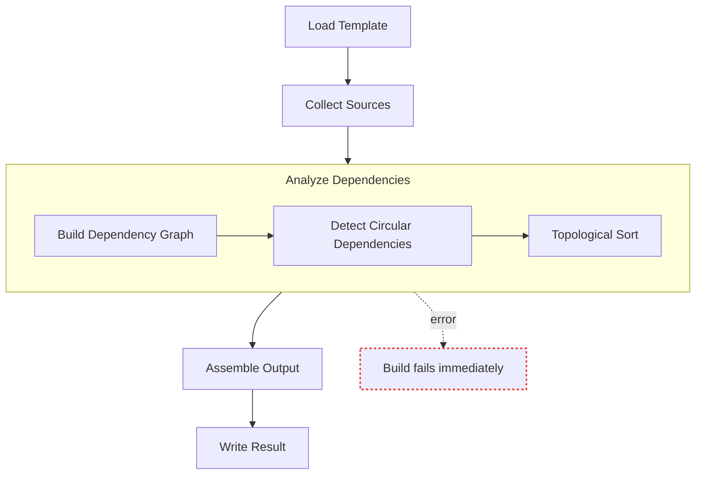

# Build Pipeline

The build pipeline collects your source files through your configured collectors and combines
them with a template to produce a single, deployable PowerShell file.

This guide assumes both are already configured — see [Collectors](collectors.md) and
[Templates](templates.md) if you haven't set them up yet — and focuses on everything that
happens once you actually run a build, from invoking it through interpreting and troubleshooting
the result.

---

## How a Build Works

A build turns your project's independently written source files into one correctly ordered,
deployable output. Rather than concatenating files in whatever order they happen to sit on disk,
PSScriptBuilder analyzes how your classes and functions actually depend on each other and
assembles them in the order that dependency requires — a class that inherits from another, for
example, always ends up after its base class in the output, regardless of which file was written
first.

PSScriptBuilder runs this analysis, and everything else a build needs, through a single call to
[`Invoke-PSScriptBuilderBuild`](../cmdlets/Invoke-PSScriptBuilderBuild.md), which walks through
the following phases in order:

1. Loads the template file
2. Runs all registered collectors
3. Builds and analyzes the dependency graph
4. Detects circular dependencies
5. Performs topological sorting
6. Replaces template placeholders with collected and dependency-resolved components
7. Optionally backs up the existing output file
8. Writes the final output file
9. Optionally writes a source map sidecar alongside the output file

The same phases, grouped:



This is a fail-fast pipeline: any step failing stops the build immediately, rather than
producing partial output. See [Error Handling](#error-handling) for what each failure looks like
and how to resolve it.

---

## Build Styles

Each style's example uses the same `MyProject` project from the
[Quick Start](../getting-started/quick-start.md) — if you haven't read it yet, start there.
All paths are relative to the project root (`$Global:PSScriptBuilderProjectRoot`), see
[Configuration](configuration.md) for setup.

PSScriptBuilder supports multiple styles for setting up a build — choose based on how much
control and readability you need:

- **Explicit** — each collector and parameter is a named variable; easy to follow, easy to extend
- **Pipeline** — collectors are chained inline; build parameters are passed as a variable
- **Fluent** — the entire build is a single pipeline expression; most concise, best for stable scripts

### Explicit

Each collector and build parameter is a named variable. This makes it easy to follow what
happens at each step and to add conditional logic if needed:

```powershell title="Build-MyProject.ps1"
$enumCollector     = New-PSScriptBuilderCollector -Type Enum     -IncludePath 'src\Enums'
$classCollector    = New-PSScriptBuilderCollector -Type Class    -IncludePath 'src\Classes'
$functionCollector = New-PSScriptBuilderCollector -Type Function -IncludePath 'src\Public'

$collectors = $enumCollector, $classCollector, $functionCollector
$contentCollector = New-PSScriptBuilderContentCollector -Collector $collectors

$result = Invoke-PSScriptBuilderBuild `
    -ContentCollector $contentCollector `
    -TemplatePath     'build\Templates\MyProject.ps1.template' `
    -OutputPath       'build\Output\MyProject.ps1'
```

The explicit style also makes it straightforward to register multiple collectors of the same
type — for example, Domain and Utils classes that should be ordered separately, each with a
unique `-CollectionKey`. See [Example 10](../examples.md#10-multiple-collectors) for a
complete walkthrough.

### Pipeline

Instead of creating collectors separately and passing them via `-Collector`, you can create and
register a collector in one step, chained directly onto `New-PSScriptBuilderContentCollector` in
a pipeline. [`Add-PSScriptBuilderCollector`](../cmdlets/Add-PSScriptBuilderCollector.md) is the
cmdlet that does this. Use this form when each collector has a straightforward configuration and
you don't need to reference them individually afterward:

```powershell title="Build-MyProject.ps1"
$contentCollector = New-PSScriptBuilderContentCollector |
    Add-PSScriptBuilderCollector -Type Enum     -IncludePath 'src\Enums'   |
    Add-PSScriptBuilderCollector -Type Class    -IncludePath 'src\Classes' |
    Add-PSScriptBuilderCollector -Type Function -IncludePath 'src\Public'

$result = Invoke-PSScriptBuilderBuild `
    -ContentCollector $contentCollector `
    -TemplatePath     'build\Templates\MyProject.ps1.template' `
    -OutputPath       'build\Output\MyProject.ps1'
```

### Fluent

The most concise form — all steps in a single pipeline expression. Best suited for simple,
stable build scripts where no intermediate variables are needed and parameters don't change:

```powershell title="Build-MyProject.ps1"
$result = New-PSScriptBuilderContentCollector |
    Add-PSScriptBuilderCollector -Type Enum     -IncludePath 'src\Enums'   |
    Add-PSScriptBuilderCollector -Type Class    -IncludePath 'src\Classes' |
    Add-PSScriptBuilderCollector -Type Function -IncludePath 'src\Public'  |
    Invoke-PSScriptBuilderBuild `
        -TemplatePath 'build\Templates\MyProject.ps1.template' `
        -OutputPath   'build\Output\MyProject.ps1'
```

---

## Using a Configuration File

Any of the three build styles — Explicit, Pipeline, or Fluent — can be combined with values read
from a configuration file, instead of hardcoded paths. The previous examples hardcode paths like
`'build\Templates\MyProject.ps1.template'` directly in the build script.

That works for simple projects, but as soon as you use the same build script in multiple
environments — or want to change paths without touching the script — it becomes a maintenance
problem.

Paths, backup settings, and output locations can instead be defined once in a configuration
file, rather than duplicated across build scripts.

[`Get-PSScriptBuilderConfiguration`](../cmdlets/Get-PSScriptBuilderConfiguration.md) reads
`psscriptbuilder.config.json` from the project root and returns these settings as a typed
`$config` object, with each value available as `$config.Build.*`. Splatting keeps the
`Invoke-PSScriptBuilderBuild` call clean — no long backtick-continuation lines:

```powershell title="Build-MyProject.ps1"
$config = Get-PSScriptBuilderConfiguration

$contentCollector = New-PSScriptBuilderContentCollector |
    Add-PSScriptBuilderCollector -Type Enum     -IncludePath 'src\Enums'   |
    Add-PSScriptBuilderCollector -Type Class    -IncludePath 'src\Classes' |
    Add-PSScriptBuilderCollector -Type Function -IncludePath 'src\Public'

$buildParams = @{
    ContentCollector = $contentCollector
    TemplatePath     = Join-Path $config.Build.TemplatePath 'MyProject.ps1.template'
    OutputPath       = Join-Path $config.Build.OutputPath   'MyProject.ps1'
    BackupPath       = $config.Build.BackupPath
    EnableBackup     = $config.Build.BackupEnabled
}

$result = Invoke-PSScriptBuilderBuild @buildParams
```

If you'd rather not write a build script by hand at all,
[`New-PSScriptBuilderProject`](../cmdlets/New-PSScriptBuilderProject.md) can generate a
ready-to-run build script for you — see [Quick Start](../getting-started/quick-start.md).

---

## Interpreting the Build Result

Every build returns a `PSScriptBuilderBuildResult` object (`$result` in the examples throughout
this guide) summarizing what was collected, how long the build took, and
where the output was written.

Use [`Format-PSScriptBuilderBuildResult`](../cmdlets/Format-PSScriptBuilderBuildResult.md) for a
quick human-readable summary, or access the properties directly when integrating into scripts
or CI pipelines:

```powershell
$result | Format-PSScriptBuilderBuildResult
```

```text title="Output"
Build Summary
  Output : ...\build\Output\MyProject.ps1
  Size   : 734 bytes
  Time   : 830.15 ms

Components
  Enums     : 1
  Classes   : 1
  Functions : 1
  Total     : 3
```

Add `-Detailed` to include all processed source files and component dependencies:

```powershell
$result | Format-PSScriptBuilderBuildResult -Detailed
```

Output — the same Build Summary and Components, now with this appended:

```text
Processed Files (3)
  ...\src\Enums\WorkStatus.ps1
  ...\src\Classes\Employee.ps1
  ...\src\Public\Get-EmployeeInfo.ps1

Component Details
  Enum:
    WorkStatus
      File : ...\src\Enums\WorkStatus.ps1

  Class:
    Employee
      File : ...\src\Classes\Employee.ps1
      Deps : WorkStatus

  Function:
    Get-EmployeeInfo
      File : ...\src\Public\Get-EmployeeInfo.ps1
      Deps : Employee
```

For direct property access — for example in CI scripts or custom reporting — the result
object exposes all details as typed properties:

```powershell
$classCount    = $result.ComponentCounts.ClassDefinitions
$functionCount = $result.ComponentCounts.FunctionDefinitions
$durationMs    = $result.ExecutionTime.TotalMilliseconds

Write-Host "Built $($result.TotalComponents) components ($classCount classes, $functionCount functions) in $durationMs ms"
Write-Host "Output: $($result.OutputPath) ($($result.OutputFileSize) bytes)"
Write-Host "Syntax valid: $($result.SyntaxValid)"

if ($result.SourceMapPath) {
    Write-Host "Source map: $($result.SourceMapPath)"
}
```

For a complete property reference see [Type Reference: Build Results](../reference/types.md#build-results).

---

## Exporting the Build Report

A build's result (`$result`, returned by `Invoke-PSScriptBuilderBuild`) can also be exported and
persisted, rather than just displayed — useful for auditing, attaching to CI artifacts, or
tracking changes between builds.

Pass `$result` to
[`Export-PSScriptBuilderBuildResult`](../cmdlets/Export-PSScriptBuilderBuildResult.md) to write
it as a structured JSON file, which can be used directly in CI artifact upload steps:

```powershell
$exportedPath = $result | Export-PSScriptBuilderBuildResult -Path 'build\reports\build.json' -Force
```

`$exportedPath` now holds the file's path as a string. The file itself
(`build\reports\build.json`) contains:

```json
{
    "generatedAt":  "2026-09-09T07:35:33Z",
    "outputPath":  "...\\build\\Output\\MyProject.ps1",
    "outputFileSizeBytes":  734,
    "backupPath":  "",
    "sourceMapPath":  "",
    "syntaxValid":  true,
    "executionTimeMs":  830,
    "totalComponents":  3,
    "componentCounts":  {
                            "usingStatements":  0,
                            "enumDefinitions":  1,
                            "classDefinitions":  1,
                            "functionDefinitions":  1,
                            "fileContents":  0
                        }
}
```

The compact output includes the build summary, component counts, and a UTC generation timestamp
added automatically. Add `-Detailed` to also include the full list of processed source files and
per-component details — type, name, source file, and dependencies:

```powershell
$result | Export-PSScriptBuilderBuildResult -Path 'build\reports\build.json' -Detailed -Force
```

`-Detailed` adds two more top-level fields. `processedFiles` lists every source file path
collected:

```json
"processedFiles":  [
                       "...\\src\\Enums\\WorkStatus.ps1",
                       "...\\src\\Classes\\Employee.ps1",
                       "...\\src\\Public\\Get-EmployeeInfo.ps1"
                   ]
```

`components` has one entry per collected component, each with its type, name, source file, and
dependencies. Here is one entry from that array, for `Employee`, as an example:

```json
"components":  [
                   {
                       "type":  "Class",
                       "name":  "Employee",
                       "sourceFile":  "...\\src\\Classes\\Employee.ps1",
                       "dependencies":  [
                                            "WorkStatus"
                                        ]
                   }
               ]
```

Use the compact export for lightweight tracking, and `-Detailed` when you need to audit exactly
which files and components went into a specific build.

---

## Logging

A build can produce a lot of diagnostic detail beyond its final result — which streams that
detail goes to depends on what you need: watching progress interactively, keeping a permanent
record, or feeding a CI system's own log capture.

PSScriptBuilder writes to three PowerShell output streams during a build:

| Stream | Content |
|--------|---------|
| **Success** | The `PSScriptBuilderBuildResult` object returned by `Invoke-PSScriptBuilderBuild` |
| **Verbose** | Step-by-step trace — collection, dependency analysis, template processing, output writing |
| **Warning** | Non-fatal notices, for example a stale source map detected during resolve |

### Interactive Use

By default, a build runs quietly — only warnings and the final result appear. When developing
or troubleshooting interactively, seeing the step-by-step trace as it happens is often more
useful than waiting for the result alone.

Add `-Verbose` to see the full trace on the console:

```powershell title="Build-MyProject.ps1"
$result = Invoke-PSScriptBuilderBuild `
    -ContentCollector $contentCollector `
    -TemplatePath     'build\Templates\MyProject.ps1.template' `
    -OutputPath       'build\Output\MyProject.ps1' `
    -Verbose

$result | Format-PSScriptBuilderBuildResult
```

Output (excerpt — the full trace is considerably longer):

```text
VERBOSE: Starting script build...
VERBOSE: Loading template from: ...\build\Templates\MyProject.ps1.template
VERBOSE: Executing content collectors...
VERBOSE: Executing collector EnumCollector with key 'ENUM_DEFINITIONS'
...
VERBOSE: Completed collector EnumCollector with key 'ENUM_DEFINITIONS' successfully
...
VERBOSE: Starting dependency analysis...
VERBOSE: Checking for circular dependencies...
VERBOSE:   No circular dependencies found
VERBOSE: Starting topological sort...
...
VERBOSE: Validating output syntax (parse check)...
VERBOSE: Output syntax is valid
VERBOSE: Script build complete in 1.36 s
```

??? note "Full verbose trace"
    ```text
    VERBOSE: Starting script build...
    VERBOSE: Loading template from: ...\build\Templates\MyProject.ps1.template
    VERBOSE: Template loaded successfully: 315 character(s)
    VERBOSE: Executing content collectors...
    VERBOSE: Starting content collection with 3 collector(s)...
    VERBOSE: Executing collector EnumCollector with key 'ENUM_DEFINITIONS'
    VERBOSE: Starting file discovery for collector EnumCollector...
    VERBOSE: Processing 1 include path(s)...
    VERBOSE:   Scanning path: src\Enums
    VERBOSE:     Found 1 file(s) matching pattern
    VERBOSE: File discovery complete: 1 file(s) to process
    VERBOSE: Collecting enum definitions from 1 file(s)...
    VERBOSE:   Parsing: WorkStatus.ps1
    VERBOSE:     Enum 'WorkStatus'
    VERBOSE:     Found 1 enum definition(s), 1 new
    VERBOSE: Collection complete: 1 unique enum definition(s), 1 new
    VERBOSE: Completed collector EnumCollector with key 'ENUM_DEFINITIONS' successfully
    VERBOSE: Executing collector ClassCollector with key 'CLASS_DEFINITIONS'
    VERBOSE: Starting file discovery for collector ClassCollector...
    VERBOSE: Processing 1 include path(s)...
    VERBOSE:   Scanning path: src\Classes
    VERBOSE:     Found 1 file(s) matching pattern
    VERBOSE: File discovery complete: 1 file(s) to process
    VERBOSE: Collecting class definitions from 1 file(s)...
    VERBOSE:   Parsing: Employee.ps1
    VERBOSE:     Class 'Employee': TypeReferences=1
    VERBOSE:     Found 1 class definition(s), 1 new
    VERBOSE: Collection complete: 1 unique class definition(s), 1 new
    VERBOSE: Completed collector ClassCollector with key 'CLASS_DEFINITIONS' successfully
    VERBOSE: Executing collector FunctionCollector with key 'FUNCTION_DEFINITIONS'
    VERBOSE: Starting file discovery for collector FunctionCollector...
    VERBOSE: Processing 1 include path(s)...
    VERBOSE:   Scanning path: src\Public
    VERBOSE:     Found 1 file(s) matching pattern
    VERBOSE: File discovery complete: 1 file(s) to process
    VERBOSE: Collecting function definitions from 1 file(s)...
    VERBOSE:   Parsing: Get-EmployeeInfo.ps1
    VERBOSE:     Function 'Get-EmployeeInfo': TypeReferences=1
    VERBOSE:     Found 1 function definition(s), 1 new
    VERBOSE: Collection complete: 1 unique function definition(s), 1 new
    VERBOSE: Completed collector FunctionCollector with key 'FUNCTION_DEFINITIONS' successfully
    VERBOSE: Content collection complete
    VERBOSE: Collection completed in 532.34 ms
    VERBOSE: System encoding is not UTF-8 (code page 1252). Checking file encodings...
    VERBOSE: All files are UTF-8 with BOM or ASCII-only
    VERBOSE: Starting dependency analysis...
    VERBOSE: Components collected from source files:
    VERBOSE:   EnumDefinitions     : 1
    VERBOSE:   ClassDefinitions    : 1
    VERBOSE:   FunctionDefinitions : 1
    VERBOSE:   Total               : 3
    VERBOSE: Building dependency graph...
    VERBOSE:   Collected 3 defined component name(s)
    VERBOSE:   Validating against 3 defined component(s)
    VERBOSE:     Analyzing 1 class(es) from collector with key 'CLASS_DEFINITIONS'...
    VERBOSE:       Employee --[type reference]--> WorkStatus
    VERBOSE:     Analyzing 1 function(s) from collector with key 'FUNCTION_DEFINITIONS'...
    VERBOSE:       Get-EmployeeInfo --[type reference]--> Employee
    VERBOSE: Dependency graph complete: 3 node(s), 2 edge(s), 0 external dependencies skipped
    VERBOSE: Checking for circular dependencies...
    VERBOSE:   Analyzing 3 node(s)...
    VERBOSE:   No circular dependencies found
    VERBOSE:   Collected 3 defined component type(s)
    VERBOSE: Starting topological sort...
    VERBOSE:   Processing 3 node(s)...
    VERBOSE:   Topological sort complete: 3 node(s) sorted
    VERBOSE:   Stabilized: 1 enum(s) output first
    VERBOSE: Analyzing cross-dependencies...
    VERBOSE:   No cross-dependencies detected
    VERBOSE: Dependency analysis complete
    VERBOSE: Dependency analysis completed in 374.72 ms
    WARNING: 2 cross-collector dependency(s) detected. Verify template placeholder order. Run with -Verbose for details.
    VERBOSE:   'Employee' (key 'CLASS_DEFINITIONS') depends on 'WorkStatus' (key 'ENUM_DEFINITIONS'). Ensure '{{ENUM_DEFINITIONS}}' precedes '{{CLASS_DEFINITIONS}}' in the template.
    VERBOSE:   'Get-EmployeeInfo' (key 'FUNCTION_DEFINITIONS') depends on 'Employee' (key 'CLASS_DEFINITIONS'). Ensure '{{CLASS_DEFINITIONS}}' precedes '{{FUNCTION_DEFINITIONS}}' in the template.
    VERBOSE: TemplateProcessor initialized with ordered components key: ORDERED_COMPONENTS (UseOrderedMode: False)
    VERBOSE: Validating template (UseOrderedMode: False)...
    VERBOSE:   Validating no CollectionKey collides with a reserved Release Management token...
    VERBOSE:     No CollectionKey collision with a reserved Release Management token
    VERBOSE:   Validating OrderedComponentsKey does not collide with a reserved Release Management token...
    VERBOSE:     No OrderedComponentsKey collision with a reserved Release Management token
    VERBOSE:   Free mode: Validating collector placeholders...
    VERBOSE:   Validating placeholder format (no whitespace)...
    VERBOSE:     All 3 placeholder(s) have correct format
    VERBOSE:     Found placeholder: {{ENUM_DEFINITIONS}}
    VERBOSE:     Found placeholder: {{CLASS_DEFINITIONS}}
    VERBOSE:     Found placeholder: {{FUNCTION_DEFINITIONS}}
    VERBOSE:     All collector placeholders found in template
    VERBOSE:   Validating for duplicate placeholders...
    VERBOSE:     No duplicate placeholders found
    VERBOSE:   Validating Using placeholder order...
    VERBOSE:     No Using placeholders found
    VERBOSE:   Validating Enum placeholder order...
    VERBOSE:     All Enum placeholders appear before Class and Function placeholders
    VERBOSE:   Validating for unknown placeholders...
    VERBOSE:     All 3 placeholder(s) are known
    VERBOSE: Template validation successful
    VERBOSE: Rendering template (UseOrderedMode: False)...
    VERBOSE:   Mode: Free (individual collector keys)
    VERBOSE:   Processing placeholder: {{ENUM_DEFINITIONS}}
    VERBOSE:     Using component order for 1 enum(s)
    VERBOSE:       Retrieving source for Enum WorkStatus
    VERBOSE:     Content prepared: 63 character(s)
    VERBOSE:   Processing placeholder: {{CLASS_DEFINITIONS}}
    VERBOSE:     Using component order for 1 class(es)
    VERBOSE:       Retrieving source for Class Employee
    VERBOSE:     Content prepared: 196 character(s)
    VERBOSE:   Processing placeholder: {{FUNCTION_DEFINITIONS}}
    VERBOSE:     Using component order for 1 function(s)
    VERBOSE:       Retrieving source for Function Get-EmployeeInfo
    VERBOSE:     Content prepared: 228 character(s)
    VERBOSE:   Template rendered with 3 replacement(s)
    VERBOSE: Template rendering complete
    VERBOSE: Template processing completed in 242.22 ms
    VERBOSE: Writing output script to: ...\build\Output\MyProject.ps1
    VERBOSE:   Script written: 731 character(s)
    VERBOSE: Output written in 13.58 ms
    VERBOSE: Validating output syntax (parse check)...
    VERBOSE: Output syntax is valid
    VERBOSE: Gathering component details for 3 component(s)...
    VERBOSE:   Retrieved 3 component detail(s)
    VERBOSE: Gathering processed files...
    VERBOSE:   Processed 3 unique file(s)
    VERBOSE: Script build complete in 1.36 s
    ```

This output isn't saved anywhere by default — see
[Capturing to a Log File](#capturing-to-a-log-file) to keep a permanent record.

### Capturing to a Log File

By default, `-Verbose` output only appears on the console — nothing is written to disk.
Redirecting it to a file lets you keep a permanent record, review it later, or attach it as a
CI artifact alongside the build.

Redirect all streams with `*>&1` and pipe to `Out-File`. `*>&1` merges every output stream —
success, verbose, warning, and error — into the success stream, since `Out-File` only writes
what actually reaches the pipeline:

```powershell
Invoke-PSScriptBuilderBuild ... -Verbose *>&1 | Out-File 'build.log'
```

The trade-off: nothing appears on the console anymore while the build runs, since everything is
redirected to the file instead. If you want to see the output *and* keep a copy, use
`Start-Transcript` instead — it records everything written to the console without redirecting
it away:

```powershell
Start-Transcript -Path 'build.log' -Append
$result = Invoke-PSScriptBuilderBuild ... -Verbose
$result | Format-PSScriptBuilderBuildResult
Stop-Transcript
```

`-Append` preserves earlier log content when the file already exists.

In a CI pipeline, this manual redirection usually isn't necessary — see [CI / CD](#ci-cd)
for how CI systems capture output automatically.

### CI / CD

CI systems such as GitLab CI and GitHub Actions capture all console output as the job log
automatically — no additional configuration is required. Run the build with `-Verbose` and the
full trace is visible in the CI run log, the same way it would be on your own console.

For a structured, machine-readable artifact instead of console output, see
[Exporting the Build Report](#exporting-the-build-report).

---

## Backup

By default no backup is created before overwriting the output file — Git is the recommended
version control mechanism.

A file-based backup can still be useful as a local safety net — for example, before a risky
change you want to undo instantly without a checkout, or in environments where the workspace is
not a Git repository.

Use `-EnableBackup` together with `-BackupPath` to enable it:

```powershell title="Build-MyProject.ps1"
$result = Invoke-PSScriptBuilderBuild `
    -ContentCollector $contentCollector `
    -TemplatePath     'build\Templates\MyProject.ps1.template' `
    -OutputPath       'build\Output\MyProject.ps1' `
    -BackupPath       'build\Backup' `
    -EnableBackup
```

Backup files are named with a timestamp:

```text
build\Backup\MyProject.ps1.260422_103045.bak
```

The backup path is included in the build result (`$result.BackupPath`) and shown by
`Format-PSScriptBuilderBuildResult` whenever a backup was actually created.

`$result.BackupPath` is `$null` in two cases:

- `-EnableBackup` wasn't specified at all
- It was specified, but there was no existing output file to back up yet — for example, on the
  very first build

A backup only makes sense once there's something to protect.

`-BackupPath` and `-EnableBackup` can also be set from a configuration file — see
[Using a Configuration File](#using-a-configuration-file), whose example already includes both.

---

## Source Maps

When something goes wrong in the built script, or when Pester measures code coverage, both
point at the compiled output file — not at the source file the problem actually lives in. A
**source map** closes that gap: it records, for every line of the output, which source file
and line it came from. Pass `-WriteSourceMap` to `Invoke-PSScriptBuilderBuild` to write a
sidecar `.sourcemap.json` next to the build's output after each successful build:

```powershell title="Build-MyProject.ps1"
$result = New-PSScriptBuilderContentCollector |
    Add-PSScriptBuilderCollector -Type Enum     -IncludePath 'src\Enums'   |
    Add-PSScriptBuilderCollector -Type Class    -IncludePath 'src\Classes' |
    Add-PSScriptBuilderCollector -Type Function -IncludePath 'src\Public'  |
    Invoke-PSScriptBuilderBuild `
        -TemplatePath 'build\Templates\MyProject.ps1.template' `
        -OutputPath   'build\Output\MyProject.ps1' `
        -WriteSourceMap
```

The sidecar path is stored in `$result.SourceMapPath` and shown by
`Format-PSScriptBuilderBuildResult` when present. `-WriteSourceMap` is also available on
`Watch-PSScriptBuilderProject` (Build mode), and can be enabled for every configuration-based
build by setting `writeSourceMap: true` in `psscriptbuilder.config.json`.

See the [Source Maps Guide](source-maps.md) for resolving output line numbers and
`ErrorRecord`s back to source, translating Pester code coverage, and the full property
reference for `PSScriptBuilderSourceLocation` and `PSScriptBuilderSourceCoverageResult`.

---

## Post-Processing

A PSScriptBuilder build output is readable, well-structured PowerShell source — comments
intact, blank lines preserved, verbose logging included. That is ideal during development,
but when deploying to production you may want to reduce file size, strip diagnostic output,
or produce a leaner file that loads faster.

This post-processing step is handled by
[`Compress-PSScriptBuilderScript`](../cmdlets/Compress-PSScriptBuilderScript.md), which operates
on an already-built output file and selectively removes comments, blank lines, and isolated
output statements — independently or in any combination. The original build output is never
modified unless you explicitly point `-DestinationPath` at the same file; typically you write to
a separate deploy location:

```powershell
Compress-PSScriptBuilderScript `
    -Path            'build\Output\MyProject.ps1' `
    -RemoveComments `
    -RemoveBlankLines `
    -DestinationPath 'deploy\MyProject.ps1' `
    -Force
```

`Compress-PSScriptBuilderScript` also accepts pipeline input from `Invoke-PSScriptBuilderBuild`
via the `OutputPath` property, so build and compress can be chained in a single expression
instead of running them as two separate steps:

```powershell title="Build-MyProject.ps1"
New-PSScriptBuilderContentCollector |
    Add-PSScriptBuilderCollector -Type Enum     -IncludePath 'src\Enums'   |
    Add-PSScriptBuilderCollector -Type Class    -IncludePath 'src\Classes' |
    Add-PSScriptBuilderCollector -Type Function -IncludePath 'src\Public'  |
    Invoke-PSScriptBuilderBuild `
        -TemplatePath 'build\Templates\MyProject.ps1.template' `
        -OutputPath   'build\Output\MyProject.ps1' |
    Compress-PSScriptBuilderScript `
        -RemoveComments `
        -RemoveBlankLines `
        -DestinationPath 'deploy\MyProject.ps1' `
        -Force
```

Both examples use `-RemoveComments` and `-RemoveBlankLines` together, but each operation
works independently and is worth understanding on its own. Three operations are available, used
independently or in any combination. Regardless of the parameter order you specify, they are
always applied in this order:

1. `-RemoveComments`
2. `-RemoveOutputStatements`
3. `-RemoveBlankLines`

This ensures that removing comments or output statements does not leave behind unexpected blank
lines.

### Removing Comments

Removes every comment in the script — single-line comments, block comments, and
`#region`/`#endregion` markers — using PowerShell's own tokenizer rather than a text search, so a
`#` inside a string or here-string is never mistaken for a comment. `#Requires` statements are
always preserved, since the PowerShell runtime requires them to remain at the top of the script.

### Removing Isolated Output Statements

Removes isolated calls to `Write-Verbose`, `Write-Debug`, `Write-Host`, `Write-Warning`, or
`Write-Information`. A call counts as isolated only when it stands completely alone as its own
statement — not chained into a pipeline, and not nested inside an `if`, `foreach`, or other
control-flow block:

```powershell title="Isolated - removed"
Write-Verbose "Starting..."
```

```powershell title="Inside control flow - kept"
if ($Verbose) { Write-Verbose "..." }
```

```powershell title="Part of a pipeline - kept"
Write-Verbose "..." | Out-Null
```

Non-isolated calls like these are skipped silently, not treated as an error; use `-Verbose` on
`Compress-PSScriptBuilderScript` itself to see which calls were skipped and why.

### Removing Blank Lines

Removes every line that contains nothing but whitespace — not just genuinely empty lines, so a
line with only spaces or tabs is removed too.

### Getting the Result Without Writing a File

Omit `-DestinationPath` to get the processed content as a string instead of writing to a file —
useful for inspecting the result, calculating size reductions, or piping into further
transformations:

```powershell
$compressed = Compress-PSScriptBuilderScript `
    -Path 'build\Output\MyProject.ps1' `
    -RemoveComments

$compressed | Measure-Object -Line
```

Post-processing is optional — skip it during development, and add it as a final step before
deploying to production.

---

## Error Handling

A build that fails partway through is harder to diagnose than one that fails immediately — a
half-written output file looks complete but silently omits components. PSScriptBuilder avoids
this entirely: `Invoke-PSScriptBuilderBuild` throws on the first error encountered and never
writes partial output.

All errors are thrown as typed exceptions with detailed messages that include the affected
component names and file paths. The most common error conditions, what causes them, and how
to resolve them:

### Missing Template File

When the specified template file does not exist:

```text
FileNotFoundException: Template file not found: 'build\Templates\MyProject.ps1.template'
```

Verify the path is correct and relative to the project root.

### Path Not Found

A collector accepts any path at creation time — path validation only happens at runtime,
when `Invoke-PSScriptBuilderBuild` triggers collection. If an `-IncludePath` directory does
not exist, the build fails with:

```text
IOException: Path not found: C:\MyProject\src\Classes (original: src\Classes)
```

The message shows both the resolved absolute path and the original value you passed, which
makes it easy to spot a typo or a missing directory. Verify that the path exists relative
to the project root and that `Set-PSScriptBuilderProjectRoot` was called before the build.

### Component Name Conflict

A class and a function with the same name within the same project are explicitly forbidden.
PSScriptBuilder uses component names as graph node keys — a collision would cause silent
incorrect ordering in the build output:

```text
InvalidOperationException: Component name conflict: 'Employee' is defined as both a Class
(in 'src\Classes\Employee.ps1') and a Function (in 'src\Public\Employee.ps1').
Classes and Functions must have unique names within a PSScriptBuilder project.
```

Rename one of the conflicting components to resolve the conflict.

### Circular Dependency

When a circular dependency is detected, the build fails immediately with a detailed error
message that includes the full cycle path:

```text
InvalidOperationException: Circular dependency detected: Employee -> Manager -> Employee
```

Resolve the cycle by removing or redirecting one of the dependencies. The
[Dependency Analysis Guide](dependency-analysis.md) explains how to query the dependency
graph to locate the cycle before running a build.

### Syntax Validation Failure

After writing the output file, PSScriptBuilder parses it to verify syntactic correctness.
If the parse fails, the build throws:

```text
InvalidOperationException: Output syntax validation failed: <parser error message>
```

`TypeNotFound` errors caused by external assemblies not loaded at build time are automatically
filtered and do not fail validation. Use `-SkipSyntaxValidation` only when the output contains
syntax that cannot be parsed at all by the PowerShell parser.

---

## See Also

- [Type Reference: Build Results](../reference/types.md#build-results) — full `PSScriptBuilderBuildResult`, `PSScriptBuilderBuildComponentCounts`, and `PSScriptBuilderBuildComponentDetail` property tables
- [File Watching Guide](file-watching.md) — automatically rebuild or run a custom script on every source change
- [Source Maps Guide](source-maps.md) — resolving line numbers/ErrorRecords and translating Pester code coverage
- [Tool Integrations Guide](tool-integrations.md) — using Pester to test the built output
- [Cmdlet Reference: Invoke-PSScriptBuilderBuild](../cmdlets/Invoke-PSScriptBuilderBuild.md)
- [Cmdlet Reference: Format-PSScriptBuilderBuildResult](../cmdlets/Format-PSScriptBuilderBuildResult.md)
- [Cmdlet Reference: Export-PSScriptBuilderBuildResult](../cmdlets/Export-PSScriptBuilderBuildResult.md)
- [Cmdlet Reference: Compress-PSScriptBuilderScript](../cmdlets/Compress-PSScriptBuilderScript.md)
