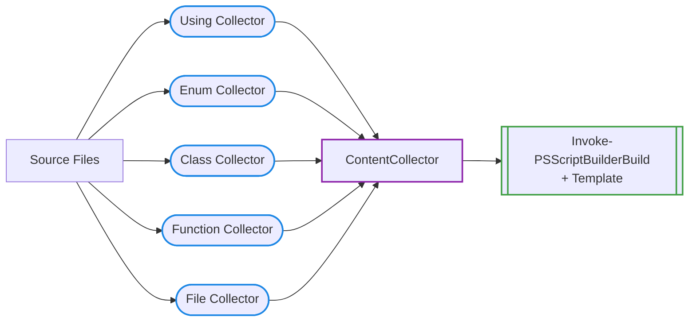

# Collectors

A **collector** is responsible for scanning source files and extracting a specific type of
PowerShell component — classes, functions, enums, using statements, or raw file contents. It
can be used standalone, or combined with others and fed into a build, which assembles the
final output script using the configured template.

Collectors scan files, not individual definitions. Every file matching the configured paths and
filters is read and all definitions of the relevant type it contains are extracted individually:

- A single file may contain multiple class definitions, multiple function definitions, or
  multiple enum definitions — the collector handles all of them transparently.
- A file may even mix definition types — a class and a function in the same file are each
  picked up by their respective collectors.

Even so, one definition per file is recommended: it's easier to navigate and version-control.

The **Class** and **Function** collectors go a step further: they parse each file into an
[AST](https://learn.microsoft.com/en-us/dotnet/api/system.management.automation.language.ast?view=powershellsdk-1.1.0)
— PowerShell's internal, structured representation of the code — to extract dependency
information without executing anything: base classes, type references, and called functions.
This allows the build to determine the correct load order and produce a topologically ordered
output script.

The collectors define *what* gets collected and *from where* — the
[template](templates.md) defines *how* it is assembled.



## Collector Types

PSScriptBuilder provides five collector types, each responsible for exactly one kind of
component:

### Using

A `Using` collector collects `using` statements — `using namespace`, `using module`, and
`using assembly` — deduplicating identical statements found across multiple files.

All registered `Using` collectors' statements are consolidated into a single, globally
deduplicated block, in every mode (Free, Ordered, and Hybrid) — registering multiple `Using`
collectors (e.g. with different `-ExcludeFile` rules per group) is fine, but exactly one `Using`
placeholder may appear in the template, and it receives everything. A second Using placeholder,
or none at all when Using collectors are registered, fails validation before the build runs
(see [Templates](templates.md#the-combined-placeholder)).

### Enum

An `Enum` collector collects enum definitions. Enums cannot reference other project types, so
they carry no dependency information — PSScriptBuilder cannot determine their position relative
to classes or functions in the template automatically, which is why [Free
Mode](templates.md#validation-modes) requires Enum placeholders to appear before Class and
Function placeholders.

### Class

A `Class` collector collects class definitions and tracks their dependencies — base classes, type
references, and called functions — so PSScriptBuilder can determine the correct load order.

### Function

A `Function` collector collects standalone function definitions — top-level `function` blocks
only, not methods defined inside a class — with the same dependency tracking as classes.

### File

A `File` collector collects entire files as raw text, without any parsing. This can include
PowerShell code — it just won't be processed by the AST engine, so no dependency tracking happens
for it. Typical uses include headers, footers, or non-PowerShell files.

## Default Keys and Tokens

Each collector also has a collection key and template token, with defaults that depend on its
type:

- The **collection key** is the identifier used internally to manage and distinguish this
  collector when it's combined with others, overridable via `-CollectionKey` (see
  [Collection Keys](#3-collection-keys)).
- The **template token** is the literal placeholder — written as `{{TOKEN}}` — that the
  [template](templates.md) uses to mark where that collector's content should appear in the
  output script.

The default key and token for each type:

| Type | Default Key | Default Token |
|---|---|---|
| `Using` | `USING_STATEMENTS` | `{{USING_STATEMENTS}}` |
| `Enum` | `ENUM_DEFINITIONS` | `{{ENUM_DEFINITIONS}}` |
| `Class` | `CLASS_DEFINITIONS` | `{{CLASS_DEFINITIONS}}` |
| `Function` | `FUNCTION_DEFINITIONS` | `{{FUNCTION_DEFINITIONS}}` |
| `File` | `FILE_CONTENTS` | `{{FILE_CONTENTS}}` |

---

## Walkthrough

Each step below is a self-contained example illustrating one collector feature, using the paths
and classes from [Example 02](../examples.md#02-classes-and-enums) throughout — get that
example's source from GitHub to run the commands exactly as shown, or substitute your own
project's directories. Steps don't build on each other: each one creates its own collector or
`ContentCollector` from scratch (most use a throwaway `$demoCollector` variable for this), so you
can jump directly to the one relevant to your question without running the others first.

### 1. Create a Standalone Collector

To scan just one component type, create a single collector directly with
`New-PSScriptBuilderCollector`, assigning the result to a variable so it can be inspected
afterward:

```powershell
$classCollector = New-PSScriptBuilderCollector -Type Class -IncludePath "src\Classes"
```

Creating a collector does not run it — nothing has been scanned yet. To see what it finds, use
`Get-PSScriptBuilderCollectorContent`, which runs the collector for you and returns the
collected data in one step:

```powershell
$classes = Get-PSScriptBuilderCollectorContent -Collector $classCollector
$classes | Format-Table Name, BaseClass, SourceFile
```

Against [Example 02](../examples.md#02-classes-and-enums)'s `Address`, `Employee`, and `Person`
classes, the output looks like this:

```text title="Expected output"
Name     BaseClass SourceFile
----     --------- ----------
Address            ...\src\Classes\Address.ps1
Employee Person    ...\src\Classes\Employee.ps1
Person             ...\src\Classes\Person.ps1
```

This standalone pattern is useful for exploring collected data interactively, or for scenarios
that only need one component type — without configuring a full build.

See [Inspecting Results](#5-inspecting-results) for additional ways to query a collector's data.

### 2. Create a ContentCollector

Most builds need more than one component type at once. Creating each one standalone with
`New-PSScriptBuilderCollector`, as in
[Create a Standalone Collector](#1-create-a-standalone-collector), leaves you with several
separate variables — but a build (and dependency or template analysis) needs all of them
handed over as a single object, not several individual collectors.

`ContentCollector` is that container: it holds several collectors together, so they can be
configured once and passed on as a single object. Create an empty one with
[`New-PSScriptBuilderContentCollector`](../cmdlets/New-PSScriptBuilderContentCollector.md).

Building it up one collector at a time from there — create each with
`New-PSScriptBuilderCollector` as before, then register it on the container separately — would
take two steps per collector.
[`Add-PSScriptBuilderCollector`](../cmdlets/Add-PSScriptBuilderCollector.md) does both in one
call instead: it uses `New-PSScriptBuilderCollector` internally, then registers the result on
the container, so any number of collectors can be chained directly onto it in a single
pipeline:

```powershell
$contentCollector = New-PSScriptBuilderContentCollector |
    Add-PSScriptBuilderCollector -Type Class -IncludePath "src\Classes"
```

`$contentCollector` is a different kind of object than `$classCollector` from
[Create a Standalone Collector](#1-create-a-standalone-collector): there, the variable held a
single collector; here, it holds the container itself — currently managing just the one
collector registered above, but able to hold any number of collectors, of any type, as more
are added.

Add the other component types the same way — using statements, enums, and functions, for
example:

```powershell
$contentCollector = $contentCollector |
    Add-PSScriptBuilderCollector -Type Using    -IncludePath "src"          |
    Add-PSScriptBuilderCollector -Type Enum     -IncludePath "src\Enums"    |
    Add-PSScriptBuilderCollector -Type Function -IncludePath "src\Functions"
```

(The reassignment isn't required for `Add-PSScriptBuilderCollector` to take effect — it just
keeps the pipeline's return value from printing to the console.)

`File` collectors combine the same way — the pattern is identical regardless of type.

The result is ready for use in a build or dependency analysis.

### 3. Collection Keys

Every collector registered on a `ContentCollector` is stored under a collection key — see
[Collector Types](#collector-types) for the default key each type uses. This key is what the
[template](templates.md)'s `{{TOKEN}}` placeholder actually looks up, and it must be unique
across the whole `ContentCollector`.

**Two names are reserved and cannot be used as a `-CollectionKey` (or as a custom
`-OrderedComponentsKey`), regardless of mode:**

- `ORDERED_COMPONENTS` (or whatever key you configured via `-OrderedComponentsKey`) — reserved
  for the combined-components placeholder itself; see [Using a Custom Combined Placeholder
  Key](templates.md#using-a-custom-combined-placeholder-key).
- Any of Release Management's built-in bump-file token names (`VERSION`, `GIT_BRANCH`,
  `BUILD_DATE`, and the rest) — see the [Release Management
  Guide](release-management.md#version-tokens)'s Version/Build/Git Tokens reference tables for
  the full list. If the same file is ever bump-managed for that token, Release Management would
  consume the placeholder before the build ever sees it.

Both are checked case-insensitively and rejected with a specific error at validation time,
instead of the generic "collector placeholder missing" error a plain typo would produce.

The same uniqueness requirement becomes a problem the moment two collectors of the same type
are needed: both default to the same key, so the second one fails to register. The key is the
only thing that decides whether registration succeeds — no other parameter changes that
outcome, `-IncludePath` included:

```powershell
$demoCollector = New-PSScriptBuilderContentCollector |
    Add-PSScriptBuilderCollector -Type Class -IncludePath "src\Core" |
    Add-PSScriptBuilderCollector -Type Class -IncludePath "src\Domain"
```

```text title="Expected output"
Add-PSScriptBuilderCollector: A collector with the key 'CLASS_DEFINITIONS' already exists in the collection.
```

To let both collectors coexist, only one of them technically needs a key that differs from the
default — a collision only happens when two collectors on the same `ContentCollector` share the
exact same key.

Even so, this example gives both an explicit, descriptive key instead of leaving one on
`CLASS_DEFINITIONS`. Leaving one at its default would make the template read unevenly:
`{{DOMAIN_CLASSES}}` names its content directly, while `{{CLASS_DEFINITIONS}}` would look like
it holds every class in the project — even though it only holds the ones under `src\Core`.
Naming both keys explicitly keeps that asymmetry out of the template: each placeholder describes
what it actually contains, so the template alone — without checking the collector setup — tells
you which classes end up where:

```powershell
$demoCollector = New-PSScriptBuilderContentCollector |
    Add-PSScriptBuilderCollector `
        -Type          Class `
        -CollectionKey "CORE_CLASSES" `
        -IncludePath   "src\Core" |
    Add-PSScriptBuilderCollector `
        -Type          Class `
        -CollectionKey "DOMAIN_CLASSES" `
        -IncludePath   "src\Domain"
```

As explained above, the template must now reference these custom keys directly, in place of the
type's usual `{{CLASS_DEFINITIONS}}` token:

```powershell title="MyScript.ps1.template"
{{CORE_CLASSES}}
{{DOMAIN_CLASSES}}
```

They still don't escape the same uniqueness requirement, though — reusing one across two
collectors hits the identical problem as the default-key collision above, just with a custom
value instead of the type's default:

```powershell
$demoCollector = New-PSScriptBuilderContentCollector |
    Add-PSScriptBuilderCollector `
        -Type          Class `
        -CollectionKey "CORE_CLASSES" `
        -IncludePath   "src\Core" |
    Add-PSScriptBuilderCollector `
        -Type          Class `
        -CollectionKey "CORE_CLASSES" `
        -IncludePath   "src\Domain"
```

```text title="Expected output"
Add-PSScriptBuilderCollector: A collector with the key 'CORE_CLASSES' already exists in the collection.
```

Only reach for multiple collectors and keys like this when you actually want the two sets
placed separately in the output — for example, keeping `{{CORE_CLASSES}}` and
`{{DOMAIN_CLASSES}}` in different sections of the template.

This only applies in **Free Mode** — the default mode, where each collector maps to its own
placeholder in the template, exactly as used throughout this guide. In
[Ordered and Hybrid Mode](templates.md#validation-modes), per-type placeholders for Class (and
Enum/Function) collectors are forbidden entirely — every one of them lands in the single
`{{ORDERED_COMPONENTS}}` block regardless of `CollectionKey`, so a custom key no longer controls
where its content ends up in the template.

If you just want to gather from several directories into one placeholder — a module's public
and private functions, for example — a single collector's `-IncludePath` already accepts
multiple values:

```powershell
New-PSScriptBuilderCollector -Type Function -IncludePath "src\Public", "src\Private"
```

`-IncludePath` controls which directories a collector scans — the next section narrows further,
controlling which individual files within them actually get processed.

### 4. Filtering Files

By default, a collector scans every `.ps1` file under its `-IncludePath` directories, recursing
into every subdirectory. That default is usually right, but real projects have exceptions:

- Test files that shouldn't be treated as source
- A legacy subdirectory not yet migrated
- Source files under an extension other than `.ps1`
- A directory whose subdirectories hold entirely unrelated content — docs, build artifacts, or
  scratch files — that should never be scanned, regardless of how many get added later
- One specific file that needs to be picked up no matter where it lives

The filter parameters below cover each of these cases:

- **Narrowing the default scan** — `-ExcludeFile`, `-ExcludePath`
- **Changing which extensions count as source** — `-FileExtension`
- **Limiting how deep it recurses** — `-NoRecurse`
- **Guaranteeing a specific file gets processed regardless of the other filters** — `-IncludeFile`

Each parameter is covered in its own section below.

#### Exclude Specific Files by Pattern

```powershell
$demoCollector = New-PSScriptBuilderContentCollector |
    Add-PSScriptBuilderCollector `
        -Type        Class `
        -IncludePath "src\Classes" `
        -ExcludeFile "*.Tests.ps1"
```

`-ExcludeFile` matches by file name only — glob patterns (`*.Tests.ps1`) and exact names
(`Legacy.ps1`) are both supported, but never a path. A match excludes every file with that name
anywhere the scan reaches, regardless of which subdirectory it lives in. Use `-ExcludePath`
instead when you need to target one specific directory rather than a name pattern.

#### Exclude Entire Subdirectories

```powershell
$demoCollector = New-PSScriptBuilderContentCollector |
    Add-PSScriptBuilderCollector `
        -Type        Class `
        -IncludePath "src\Classes" `
        -ExcludePath "src\Classes\Legacy"
```

`-ExcludePath` matches by directory, not by name — excluding a path also excludes every file in
every subdirectory beneath it. The match respects directory boundaries, so excluding
`src\Classes\Legacy` does not also exclude an unrelated sibling like `src\Classes\LegacyV2`.

#### Scan Additional File Extensions

```powershell
$demoCollector = New-PSScriptBuilderContentCollector |
    Add-PSScriptBuilderCollector `
        -Type          Class `
        -IncludePath   "src\Classes" `
        -FileExtension ".ps1", ".psm1"
```

`-FileExtension` replaces the default entirely — if specified, only the listed extensions are
scanned. To keep `.ps1` alongside additional types, always include it explicitly.

#### Scan Only the Top-Level Directory

```powershell
$demoCollector = New-PSScriptBuilderContentCollector |
    Add-PSScriptBuilderCollector `
        -Type        Class `
        -IncludePath "src\Classes" `
        -NoRecurse
```

Reach for `-NoRecurse` when an entire directory's subdirectories should never be scanned,
without having to name each one individually via `-ExcludePath` — useful for a directory whose
subdirectories hold unrelated content that may grow over time.

#### Include Specific Files Explicitly

```powershell
$demoCollector = New-PSScriptBuilderContentCollector |
    Add-PSScriptBuilderCollector `
        -Type        Class `
        -IncludeFile "src\Classes\MyClass.ps1", "src\Classes\BaseClass.ps1"
```

`-IncludeFile` bypasses every other filter: `-ExcludeFile`, `-ExcludePath`, and `-FileExtension`
all only apply to files discovered via `-IncludePath`. A file listed explicitly with
`-IncludeFile` is always processed exactly as given, regardless of any exclusion pattern or
extension restriction that would otherwise apply to it.

Prefer `-IncludePath` over `-IncludeFile` for directories: `-IncludePath` picks up new files
automatically as your project grows, while `-IncludeFile` requires updating the list by hand.
Reach for `-IncludeFile` only when you need precise control over a small, fixed set of files.

### 5. Inspecting Results

Whether a collector is standalone (see [Create a Standalone
Collector](#1-create-a-standalone-collector)) or registered on a `ContentCollector`, you can
inspect it directly — which collectors are registered, what they found, and specific items by
name. This is useful for debugging, verifying filter configurations, or exploring collected data
before running a full build. The examples below use this `ContentCollector`:

```powershell
$demoCollector = New-PSScriptBuilderContentCollector |
    Add-PSScriptBuilderCollector -Type Using    -IncludePath "src"          |
    Add-PSScriptBuilderCollector -Type Enum     -IncludePath "src\Enums"    |
    Add-PSScriptBuilderCollector -Type Class    -IncludePath "src\Classes"  |
    Add-PSScriptBuilderCollector -Type Function -IncludePath "src\Functions"
```

#### List All Registered Collectors

To confirm what's currently registered on a `ContentCollector` — useful before a build, or when
debugging an unexpected result — list every collector at once:

```powershell
Get-PSScriptBuilderCollector -ContentCollector $demoCollector | Format-Table CollectionKey
```

```text title="Expected output"
CollectionKey
-------------
USING_STATEMENTS
ENUM_DEFINITIONS
CLASS_DEFINITIONS
FUNCTION_DEFINITIONS
```

#### Get a Collector by Key

Once you know which collector you need — from the list above, or from its default key
documented in [Collector Types](#collector-types) — retrieve it directly by key instead of
picking it out of the full list:

```powershell
$classCollector = Get-PSScriptBuilderCollector `
    -ContentCollector $demoCollector `
    -CollectionKey    "CLASS_DEFINITIONS"
```

From here, `Get-PSScriptBuilderCollectorContent` works exactly as in
[Create a Standalone Collector](#1-create-a-standalone-collector) — it does not matter whether
the collector came from a `ContentCollector` or was created standalone. Each item it returns is
a typed data object whose properties depend on the collector type — see
[Collected Data Properties](#collected-data-properties) in the Reference section.

#### Look Up a Specific Item by Name

With a specific collector in hand, retrieve one specific item directly by name instead of
iterating through everything it collected:

```powershell
$data = Get-PSScriptBuilderCollectorContent -Collector $classCollector -ItemName "Employee"
$data.SourceCode
```

```text title="Expected output"
class Employee : Person {
    [Address]          $Address
    [Department]       $Department
    [EmploymentStatus] $Status
    [DateTime]         $HireDate
    [decimal]          $Salary

    Employee(
        [string]           $firstName,
        [string]           $lastName,
        [Address]          $address,
        [Department]       $department,
        [DateTime]         $hireDate,
        [decimal]          $salary
    ) : base($firstName, $lastName) {
        $this.Address    = $address
        $this.Department = $department
        $this.Status     = [EmploymentStatus]::Active
        $this.HireDate   = $hireDate
        $this.Salary     = $salary
    }
}
```

What counts as a name depends on the collector type: a class, function, or enum name for those
collectors; a file's name for a `File` collector; and the complete `using` statement text — not
just the namespace or module name — for a `Using` collector. All matches are case-insensitive.

For a `Using` collector, that means passing the full statement. The returned object's
`SourceFiles` property lists every file where the statement was found — since a `using`
statement is deduplicated across files, the same statement appearing in more than one file
still returns as a single item:

```powershell
$usingCollector = New-PSScriptBuilderCollector -Type Using -IncludePath "src"
$usingStatement = Get-PSScriptBuilderCollectorContent `
    -Collector $usingCollector `
    -ItemName  "using namespace System.Collections.Generic"
$usingStatement.SourceFiles
```

```text title="Expected output"
...\src\Classes\MyClass.ps1
...\src\Classes\BaseClass.ps1
```

#### Look Up Multiple Items Efficiently

`Get-PSScriptBuilderCollectorContent` doesn't scan the files itself — it calls the collector's
own `.Collect()` method internally, then returns the data you asked for. That method is public:
nothing stops you from calling it directly instead.

To look up more than one item from the same collector, calling
`Get-PSScriptBuilderCollectorContent -ItemName` again for each one works, but reruns
`.Collect()` — a full reset and file rescan — every time:

```powershell
$employee = Get-PSScriptBuilderCollectorContent -Collector $classCollector -ItemName "Employee"
$address = Get-PSScriptBuilderCollectorContent -Collector $classCollector -ItemName "Address"
```

Calling `.Collect()` yourself once instead, then querying the dictionary directly, avoids the
repeated rescans:

```powershell
$classCollector.Collect()
$employee = $classCollector.ClassData['Employee']
$address = $classCollector.ClassData['Address']
```

### 6. Updating Collector Configuration

A `ContentCollector` is mutable — collectors can be removed and replaced after the initial
setup. This is useful when build logic is conditional: for example, when a collector's path
or type depends on a parameter passed to the build script.

Say a `$demoCollector` currently has a `Function` collector under a custom key:

```powershell
$demoCollector = New-PSScriptBuilderContentCollector |
    Add-PSScriptBuilderCollector `
        -Type          Function `
        -CollectionKey "OLD_FUNCTIONS" `
        -IncludePath   "src\Functions"
```

To remove a registered collector by key, use
[`Remove-PSScriptBuilderCollector`](../cmdlets/Remove-PSScriptBuilderCollector.md). The
operation is idempotent — removing a non-existent key produces a warning, not an error.
Chained with `Add-PSScriptBuilderCollector`, it replaces the old collector with a new one in a
single pipeline:

```powershell
$demoCollector = $demoCollector |
    Remove-PSScriptBuilderCollector -CollectionKey "OLD_FUNCTIONS" |
    Add-PSScriptBuilderCollector `
        -Type          Function `
        -CollectionKey "NEW_FUNCTIONS" `
        -IncludePath   "src\Functions\v2"

Get-PSScriptBuilderCollector -ContentCollector $demoCollector | Format-Table CollectionKey
```

```text title="Expected output"
CollectionKey
-------------
NEW_FUNCTIONS
```

See [Stale Data After Modification](#stale-data-after-modification) for an important caveat
about modifying a `ContentCollector` that has already been executed.

---

## Cross-Collector Dependencies

When components in different collectors depend on each other — through inheritance, type
references, static initializers, or called functions — PSScriptBuilder tracks the relationship
and warns if the template's placeholder order might not match it. This only applies in
[Free Mode](templates.md#validation-modes); Ordered and Hybrid Mode place all Enum, Class, and
Function components in a single, automatically-ordered block, so cross-collector order is never
a concern there.

The actual consequence of ignoring the warning differs by cause:

- **Inheritance** genuinely requires the correct order: PowerShell resolves a base class the
  moment the `class X : Y` statement is parsed, so if `Y`'s collector placeholder comes after
  `X`'s, the built script fails to even load, with `Unable to find type [Y]`. PSScriptBuilder's
  own build-time syntax check cannot catch this — it deliberately ignores `TypeNotFound` errors,
  since they're also produced by legitimate external type references. The warning is the only
  safety net.
- **Type references and static initializer references** — a property's type, a static field's
  initializer expression — are resolved lazily once the whole script has loaded, so their order
  in the template doesn't actually affect correctness.
- **Called functions** aren't left to placeholder order at all: a class depending on a function
  automatically requires [Ordered Mode](templates.md#validation-modes), and the build fails
  validation outright until the template provides `{{ORDERED_COMPONENTS}}`.
- A genuinely **circular** dependency — regardless of which of the above caused it — is caught
  during the build itself, which fails with `Circular dependency detected: ...` before a broken
  script could ever be produced.

In practice, inheritance is the one case that requires you to actively verify placeholder order
yourself. See the [Dependency Analysis Guide](dependency-analysis.md#dependencies-across-collectors)
for a full explanation and examples.

---

## Stale Data After Modification

A `ContentCollector` that has already been executed — directly via `.Execute()`, or as part of
a build — can end up holding inconsistent data if you modify it afterward: some collectors show
real results while others show none at all.

This happens because adding or removing a collector doesn't trigger a new collection run.
Existing collectors keep whatever data they gathered the last time `.Execute()` ran, while a
newly added collector starts with `HasCollected` still `$false` and no data collected yet.

```powershell
$demoCollector = New-PSScriptBuilderContentCollector |
    Add-PSScriptBuilderCollector -Type Class -IncludePath "src\Classes"
$demoCollector.Execute()

$demoCollector = $demoCollector |
    Add-PSScriptBuilderCollector -Type Function -IncludePath "src\Functions"

$classCollector = Get-PSScriptBuilderCollector `
    -ContentCollector $demoCollector `
    -CollectionKey    "CLASS_DEFINITIONS"

$funcCollector = Get-PSScriptBuilderCollector `
    -ContentCollector $demoCollector `
    -CollectionKey    "FUNCTION_DEFINITIONS"
```

```text title="Expected output"
$classCollector.HasCollected  # True  - already has data from the earlier Execute()
$funcCollector.HasCollected   # False - never collected
```

Re-run the affected step — a fresh build, or `.Execute()` yourself — before relying on the
`ContentCollector`'s data again.

---

## Reference

### Parameters

`New-PSScriptBuilderCollector` and `Add-PSScriptBuilderCollector` share the exact same
parameter set — unsurprising, since `Add-PSScriptBuilderCollector` calls
`New-PSScriptBuilderCollector` internally before registering the result on a `ContentCollector`
(see [Create a ContentCollector](#2-create-a-contentcollector)).

Every parameter here was already demonstrated in context earlier in this guide: `-CollectionKey`
in [Collection Keys](#3-collection-keys), and the rest in [Filtering Files](#4-filtering-files).

See [Cmdlet Reference: New-PSScriptBuilderCollector](../cmdlets/New-PSScriptBuilderCollector.md)
or [Cmdlet Reference: Add-PSScriptBuilderCollector](../cmdlets/Add-PSScriptBuilderCollector.md)
for the full parameter table.

### File Resolution Rules

- Relative paths are resolved against the project root — see the
  [Configuration Guide](configuration.md#project-root-discovery) for how that's determined and
  how to override it
- A non-existent `-IncludePath` produces a **warning** at collector creation time — the
  collector is still created to support scenarios where the directory is generated later.
  At collection time (when the build runs), a still-missing path throws an `IOException`.
- `-NoRecurse` only affects `-IncludePath` scanning; `-IncludeFile` entries are always explicit

### Collected Data Properties

Every collector, once run, returns one data object describing each item it finds in your source
files: a class, a function, an enum, a using statement, or a file, depending on the collector's
type. The exact structure of that data object differs accordingly — `Name`, `SourceCode`, and
`SourceFile` are common to `Class`, `Function`, and `Enum`, while `Using` and `File` expose a
different, purpose-specific set instead — reflecting that a using statement and a raw file are
conceptually different from a named PowerShell definition.

The remaining properties — `BaseClass`, `TypeReferences`, `StaticInitializerReferences`, and
`CalledFunctions` — are what PSScriptBuilder itself uses internally to build the dependency
graph that drives topological sorting and cross-collector dependency detection (see
[Cross-Collector Dependencies](#cross-collector-dependencies)). Like everything else a collector
extracts, they come from static AST analysis, not from running any code, and they're available
to you the same way — whether you're inspecting a collector interactively, as in
[Inspecting Results](#5-inspecting-results), or writing your own validation logic against
collected data.

The full property reference:

| Property | Applies To | Description |
|---|---|---|
| `Name` | Class, Function, Enum | Component name |
| `SourceCode` | Class, Function, Enum | Exact source code as extracted from the file |
| `SourceFile` | Class, Function, Enum | Path to the file it was collected from |
| `BaseClass` | Class | Name of the inherited class, or empty if none. Has a hard load-order requirement — see [Cross-Collector Dependencies](#cross-collector-dependencies) |
| `TypeReferences` | Class, Function | Non-built-in types referenced in the body (property/parameter types, return types, casts) |
| `StaticInitializerReferences` | Class | Types referenced in static property initializer expressions |
| `CalledFunctions` | Class, Function | Names of other project-defined functions called in the body. A `Class` calling a function this way requires [Ordered Mode](templates.md#validation-modes) — see [Cross-Collector Dependencies](#cross-collector-dependencies) |
| `Statement` | Using | The full `using namespace`/`using module` statement |
| `SourceFiles` | Using | Every file where the statement was found (deduplicated) |
| `FileName` | File | The file's name |
| `FullPath` | File | The file's absolute path |
| `Content` | File | The complete raw file content |

### Execution Order

Collectors always execute in a fixed order — `Using`, `Enum`, `Class`, `Function`, `File` —
regardless of the order you registered them in. Whether you call
`Add-PSScriptBuilderCollector` for `Function` before `Class`, or the other way around, execution
always follows this same sequence; a `ContentCollector` groups its collectors internally by type
before running any of them.

This means you don't need to think about registration order when building a `ContentCollector`
— add collectors in whatever order is most convenient for your build script, and
PSScriptBuilder handles the rest.

| Order | Type |
|---|---|
| 1 | `Using` |
| 2 | `Enum` |
| 3 | `Class` |
| 4 | `Function` |
| 5 | `File` |

This is the order of the *collection phase* only — it determines when each collector's files
are scanned, not where its content ends up in the final output. The position of each
collector's output in the assembled script is controlled entirely by the template's placeholder
order — see the [Templates Guide](templates.md).

---

## See Also

- [Templates Guide](templates.md) — how a collector's `CollectionKey` becomes a template placeholder
- [Dependency Analysis Guide](dependency-analysis.md) — how class and function dependencies are resolved
- [File Watching Guide](file-watching.md) — every collector's `-IncludePath` is watched recursively for automatic rebuilds
- [Type Reference: Collectors](../reference/types.md#collectors) — `PSScriptBuilderContentCollector` method table and collected data type summary

