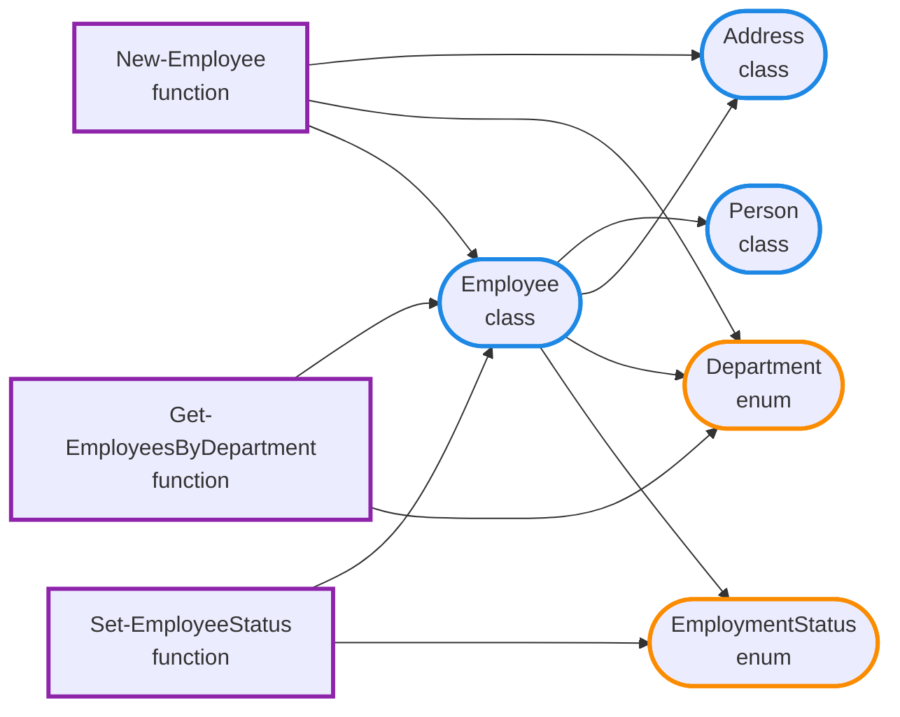
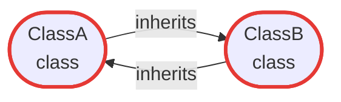
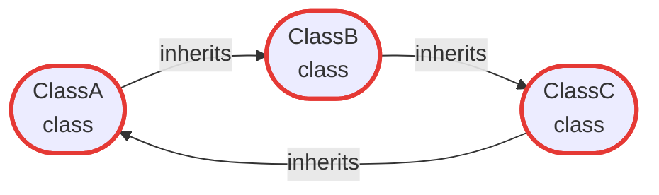
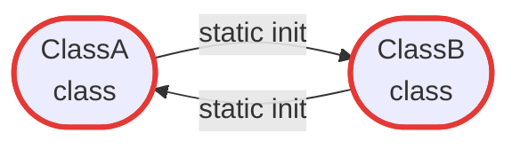
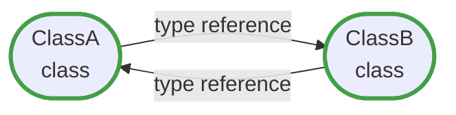
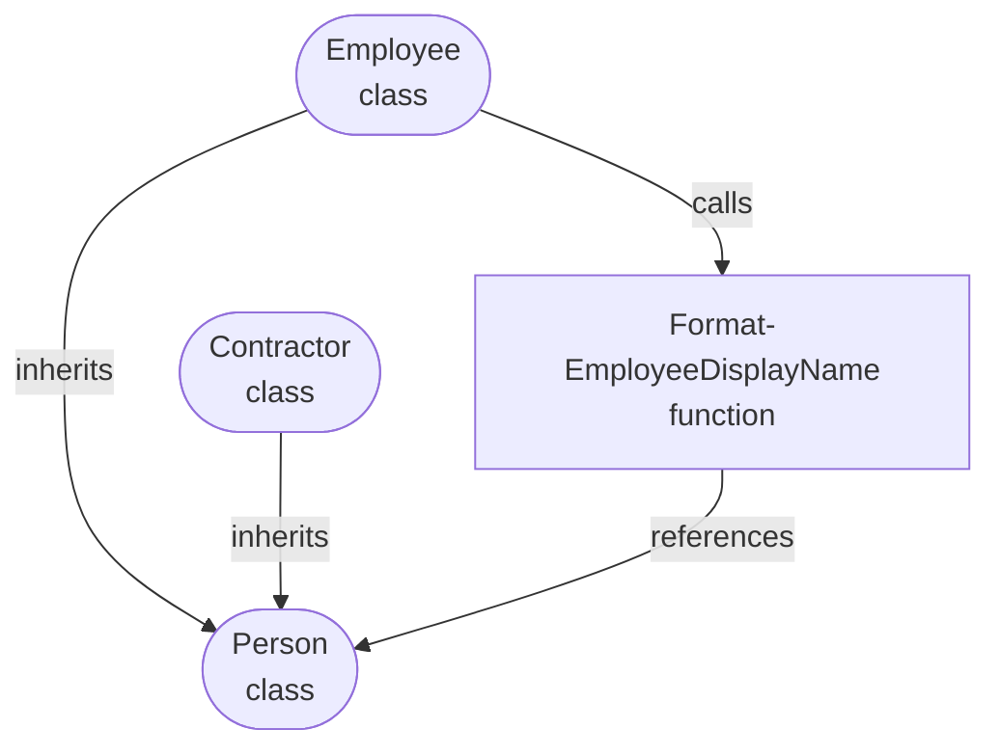

# Dependency Analysis

PSScriptBuilder uses PowerShell AST analysis to build a dependency graph of all collected
components, then sorts it to determine the correct load order for the generated output
script. This sort ensures that base classes always appear before derived classes, and that
interdependent components are placed in the right sequence — automatically, without any
manual ordering.

The following sections explain how PSScriptBuilder builds that graph, how it sorts it, and
what happens when it can't produce a valid order — read them first if you're new to
dependency analysis, or jump straight to [Walkthrough](#walkthrough) if you just want to see
the cmdlets in action.

---

## The Dependency Graph

Before PSScriptBuilder can determine a load order, it builds a dependency graph from every
component the configured collectors found. The graph is a **directed graph**: each node is a
component — a class, function, or enum — and each edge points from a component to something
it depends on.

PSScriptBuilder tracks four kinds of edges:

- **Inheritance** — a class inherits from another class (`class Derived : Base`)
- **TypeReference** — a property, parameter, or return type references another component's type
- **FunctionCall** — a function or method calls another function
- **StaticInitializer** — a static field's initializer expression references another component

Once the graph is built, PSScriptBuilder sorts it into a single, linear load order — the topic
of the next section.

---

## Topological Sort

PSScriptBuilder runs this sort as part of every dependency analysis, converting the graph into
a single, linear load order — the exact sequence components will appear in the output script.
It uses **[Kahn's algorithm](https://en.wikipedia.org/wiki/Topological_sorting#Kahn's_algorithm)**,
which guarantees:

- Every prerequisite always appears before its dependents
- Enums are always placed first (they have no dependencies)
- Independent components — those with no ordering constraint between them — are also ordered
  deterministically: classes before functions, alphabetically within each type

The following example uses [Example 06 — Hybrid Mode](../examples.md#06-hybrid-mode)'s real
dependency graph — every component and edge in this example actually exists in that project's
source. It has eight components:

- **Department** — enum, no dependencies
- **EmploymentStatus** — enum, no dependencies
- **Address** — class, no dependencies
- **Person** — class, no dependencies
- **Employee** — class, inherits from `Person`; also references `Address`, `Department`, and `EmploymentStatus`
- **Get-EmployeesByDepartment** — function, depends on `Employee` and `Department`
- **New-Employee** — function, depends on `Address`, `Department`, and `Employee`
- **Set-EmployeeStatus** — function, depends on `Employee` and `EmploymentStatus`

This is the complete graph — all eleven edges between them:



Running dependency analysis on this project produces the following load order:

| Load order | Component | Type | Reason |
|---|---|---|---|
| 1 | `Department` | Enum | Always placed first (tied with `EmploymentStatus`, ordered alphabetically) |
| 2 | `EmploymentStatus` | Enum | Tied with `Department`, ordered alphabetically |
| 3 | `Address` | Class | No dependencies (tied with `Person`, ordered alphabetically) |
| 4 | `Person` | Class | No dependencies (tied with `Address`, ordered alphabetically) |
| 5 | `Employee` | Class | Inherits from `Person`; also references `Address`, `Department`, and `EmploymentStatus` — all four must be placed first |
| 6 | `Get-EmployeesByDepartment` | Function | Depends on `Employee` and `Department` (tied with `New-Employee` and `Set-EmployeeStatus`, ordered alphabetically) |
| 7 | `New-Employee` | Function | Depends on `Address`, `Department`, and `Employee` (tied, ordered alphabetically) |
| 8 | `Set-EmployeeStatus` | Function | Depends on `Employee` and `EmploymentStatus` (tied, ordered alphabetically) |

Both enums are placed first, before anything else, simply because enums have no dependencies
by definition. `Address` and `Person` are tied next — neither depends on the other, so
alphabetical order breaks the tie. `Employee` only becomes eligible once all four of its
dependencies — `Person`, `Address`, `Department`, and `EmploymentStatus` — have been placed;
its position is determined entirely by those real dependencies, not by any tie-break.

The three functions become eligible together, right after `Employee` is placed, since each of
them depends on `Employee` and nothing else that isn't already placed. With no dependency
between them, alphabetical order decides their relative sequence: `Get-EmployeesByDepartment`,
then `New-Employee`, then `Set-EmployeeStatus`.

This example demonstrates two of the three ordering guarantees clearly: enums-first, and
prerequisites-before-dependents. It doesn't demonstrate the third guarantee — classes before
functions — because none of these three functions is ever competing with an unplaced class for
the tie-break; each already has a real dependency on `Employee` that decides its position
instead.

No real, existing example can show this third guarantee in isolation — every example with
classes also has functions that depend on those classes. That's not a real problem, though: the
rule itself is simple enough to state directly and needs no worked example to be understood —
whenever a class and a function are both eligible at the same point in the sort, the class is
placed first, with no exceptions.

---

## Circular Dependencies

A circular dependency exists when two or more components depend on each other — directly, or
through a chain — so no valid load order can place all of them correctly relative to one
another. PSScriptBuilder distinguishes two kinds: fatal cycles and type reference cycles.
Understanding the difference matters — one prevents the build entirely, the other is handled
automatically.

### Fatal cycles

A cycle is fatal when it creates an unresolvable ordering constraint at PowerShell load time.
PowerShell processes a script file from top to bottom: before any code runs, it works through all
type definitions in order. A class must appear in the file after the types it depends on — otherwise,
PowerShell cannot resolve the type at load time and the script fails immediately with a type-not-found
error.

Two dependency types create this ordering constraint:

**Inheritance** — when class A inherits from class B, class B must already be defined at the point
where class A is loaded. If two classes inherit from each other — directly or through a chain —
there is no valid top-to-bottom order that satisfies both requirements at the same time.

A direct cycle involves just two classes:

```powershell title="Direct inheritance cycle"
class ClassA : ClassB { }  # ClassA requires ClassB to be defined first
class ClassB : ClassA { }  # ClassB requires ClassA to be defined first — impossible
```



A chain cycle can span any number of classes — the result is the same:

```powershell title="Chain inheritance cycle"
class ClassA : ClassB { }  # ClassA requires ClassB
class ClassB : ClassC { }  # ClassB requires ClassC
class ClassC : ClassA { }  # ClassC requires ClassA — cycle: A → B → C → A
```



**Static property initializers** — when PowerShell reads a class definition, it immediately runs
any static property initializer expressions. A static initializer is therefore not just a
declaration — it is code that executes at load time. Any type referenced in the initializer must
already be defined at that point — the same hard requirement as inheritance.

```powershell title="Mutual static initializer cycle"
class ClassA {
    static [ClassB] $Default = [ClassB]::new()  # [ClassB]::new() runs when ClassA loads
}

class ClassB {
    static [ClassA] $Default = [ClassA]::new()  # [ClassA]::new() runs when ClassB loads
}
```



If ClassA has a static initializer that references ClassB, and ClassB has a static initializer
that references ClassA, neither can be loaded first. This is just as fatal as a direct inheritance
cycle, and PSScriptBuilder treats it accordingly.

PSScriptBuilder detects both cycle types before attempting to sort, and two cmdlets can surface
a cycle — each reacting differently:

- [`Get-PSScriptBuilderDependencyAnalysis`](../cmdlets/Get-PSScriptBuilderDependencyAnalysis.md)
  reports a cycle via `HasCycles`/`CyclePath` without throwing, so your script can decide how to
  react.
- [`Invoke-PSScriptBuilderBuild`](../cmdlets/Invoke-PSScriptBuilderBuild.md) (which runs the same
  analysis internally) throws immediately instead, with a clear error naming all components
  involved.

Either way, the error must be resolved in the source code — there is no workaround.

### Type reference cycles

A type reference cycle occurs when two classes reference each other inside method bodies. At
first glance this looks like the same problem — but it is fundamentally different.

Method bodies are not executed when the class is loaded; they only run when the method is
called. By the time any method is called, all class definitions in the module have already been
loaded and are available. So it does not matter in which order the classes appear in the file.

```powershell title="Mutual type reference cycle"
class ClassA {
    [void] Run() {
        $b = [ClassB]::new()  # only executed when Run() is called, not on load
    }
}

class ClassB {
    [void] Run() {
        $a = [ClassA]::new()  # only executed when Run() is called, not on load
    }
}
```



Whether `ClassA` or `ClassB` appears first in the file makes no difference here. PowerShell
parses all class definitions in the output script together, so both types are known before any
method body is ever invoked.

PSScriptBuilder detects and resolves these cycles automatically. No build failure occurs and no
changes to the source code are required.

---

## Cross-Dependencies

A cross-dependency exists when a dependency crosses the boundary between component types —
specifically, when a class's method body or static initializer calls a function, the one
direction Free Mode's classes-then-functions layout cannot accommodate. When it does, classes
and functions can no longer be emitted as two separate blocks; a single per-type placeholder is
no longer enough to express a valid load order. PSScriptBuilder detects this automatically and
requires the template to accommodate it.

### Free Mode, Hybrid Mode, and Ordered Mode

PSScriptBuilder chooses between three template modes based on the dependency graph: **Free
Mode** (all enums, then all classes, then all functions — used whenever nothing forces
otherwise), **Ordered Mode** (activated automatically once a class depends on a function), and
**Hybrid Mode** (the same layout as Ordered Mode, opted into manually even without
cross-dependencies yet). See the [Templates Guide](templates.md#3-ordered-mode-and-hybrid-mode)
for the full explanation and the required template structure for each.

**Practical implication:** Whether Ordered Mode is triggered depends on the actual dependency
relationships between your classes and functions — not on how they are organized across
collectors or directories. Use `Get-PSScriptBuilderDependencyAnalysis` to check whether
cross-dependencies exist before designing your template. If they do, replace all per-type
placeholders for enums, classes, and functions with a single ordered-components placeholder
(default: `{{ORDERED_COMPONENTS}}`). Alternatively, use Hybrid Mode to adopt this layout
proactively, even when no cross-dependencies currently exist.

### Class methods that call functions

Free Mode's fixed layout — all classes first, then all functions — already satisfies *any*
function depending on a class, no matter how indirectly. A factory function that constructs and
returns a class instance, or a function that calls another function which in turn references a
class, never forces interleaving: every class the call chain eventually touches is still emitted
before every function, exactly as Free Mode assumes.

**The only direction Free Mode cannot satisfy is the opposite one: a class whose own method
body or static initializer calls a function.** That function must then be emitted before the
class that calls it — which contradicts the fixed classes-then-functions layout and forces
interleaving. Consider this scenario:



`Employee`'s own `ToString()` method calls `Format-EmployeeDisplayName`, and that function takes
a `Person` parameter.

```powershell title="Method calls a function — PSScriptBuilder detects a cross-dependency"
class Employee : Person {
    [string] ToString() {
        return Format-EmployeeDisplayName -Employee $this
    }
}
```

The topological sort must place `Format-EmployeeDisplayName` after `Person`
(the function needs the type) but before `Employee` (the class calls the function) — which means
a function has to appear between class definitions. PSScriptBuilder detects the Class→Function
transition and activates Ordered Mode. `Contractor` also extends `Person` but calls no function,
so its position relative to `Format-EmployeeDisplayName` is unconstrained.

Moving the formatting logic directly into the method removes the class-to-function dependency:

```powershell title="Logic inlined — no cross-dependency"
class Employee : Person {
    [string] ToString() {
        return "$($this.FirstName) $($this.LastName)"
    }
}
```

The only change between the two versions is inside `ToString()`: the call to
`Format-EmployeeDisplayName` is replaced with the same formatting logic written directly in the
method body.

With the logic inlined, no class depends on a function. The topological sort places all classes
first, then all functions, and PSScriptBuilder stays in Free Mode.

This is not a limitation — PSScriptBuilder correctly analyses what is actually in the code. A
class method calling a function creates a real dependency, and PSScriptBuilder responds by
choosing the mode that guarantees a valid output. Delegating logic from a class method to a
standalone function is a design decision with consequences for the build mode; calling a
function *from* another function, or constructing a class instance inside a function, is not.

Which approach makes sense depends on your project's current template structure and the class
method's own complexity:

| Situation | Recommendation |
|-----------|----------------|
| Project already uses `{{ORDERED_COMPONENTS}}` | Class methods calling functions are fine — cross-dependencies are handled |
| Project uses per-type or per-layer placeholders | Keep class method logic self-contained, or accept Ordered Mode for the classes that need it |
| A class method's delegated logic is substantial | Use it and accept Ordered Mode, or move the logic into the class method itself |

See [Example 07](../examples.md#07-ordered-mode) for a complete project that illustrates this
behaviour.

---

## Dependencies Across Collectors

A cross-collector dependency exists when a component registered in one collector depends on a
component registered in a different one. PSScriptBuilder resolves these dependencies —
inheritance, type references, static initializer references, and called functions — across the
full set of collectors combined, and always sorts components correctly *within* a single
template placeholder. Across placeholders, though, PSScriptBuilder cannot reorder your template
for you, so whether a wrong order actually breaks anything depends on which kind of dependency
crosses the collector boundary.

### Dependency Kinds

Four kinds of dependency can cross a collector boundary, each with different consequences:

#### Inheritance: order matters, and PSScriptBuilder can't catch a mistake for you

Consider two collectors where `DerivedClass` inherits from `BaseClass`:

```powershell
$contentCollector = New-PSScriptBuilderContentCollector |
    Add-PSScriptBuilderCollector `
        -Type          Class `
        -CollectionKey "CORE_CLASSES" `
        -IncludePath   "src\Core" |
    Add-PSScriptBuilderCollector `
        -Type          Class `
        -CollectionKey "DOMAIN_CLASSES" `
        -IncludePath   "src\Domain"
```

`CORE_CLASSES` contains `BaseClass`; `DOMAIN_CLASSES` contains `DerivedClass : BaseClass`.
Whether the resulting script is valid depends entirely on which placeholder comes first in the
template:

```powershell title="Correct template order"
{{CORE_CLASSES}}
{{DOMAIN_CLASSES}}
```

```powershell title="Incorrect template order — fails when the script is loaded"
{{DOMAIN_CLASSES}}
{{CORE_CLASSES}}
```

PowerShell resolves a base class the moment the `class DerivedClass : BaseClass` statement is
*parsed*, so the wrong order fails immediately when the script loads, with
`Unable to find type [BaseClass]`.

This is not caught by PSScriptBuilder's own build-time syntax check, which parses the output
with a pure grammar parser and deliberately ignores `TypeNotFound` errors, since the same error
ID is also produced by legitimate references to external assembly types not yet loaded at build
time. The build succeeds either way — the warning described in
[Cross-Collector Dependency Warning](#cross-collector-dependency-warning) is the only thing that
can catch this before it becomes a real failure.

#### Type references and static initializers: order doesn't actually matter

A property's type, a parameter's type, or a static field's initializer expression referencing a
type in another collector — for example, a function whose parameter is typed as a class from a
different collector — is resolved lazily by PowerShell, once the whole script has loaded. The
order these placeholders appear in the template has no effect on correctness for these cases.

#### Called functions: PSScriptBuilder removes the ordering burden entirely

When a class depends on a function — its constructor or a method calls a project-defined
function — PSScriptBuilder doesn't just warn about placeholder order here, the way it does for
inheritance: it refuses to build a Free Mode template at all. Combining both collectors in a
Free Mode template fails validation outright:

```text title="Expected output"
Template validation failed: In cross-dependencies mode, template MUST contain placeholder '{{ORDERED_COMPONENTS}}'.
```

Switch to [Ordered or Hybrid Mode](templates.md#validation-modes) and the class and function are
placed in the correct order automatically — no manual placeholder ordering needed.

#### Circular dependencies: caught before a script is ever produced

Whenever a dependency between two collectors forms a genuine cycle — two classes whose static
initializers reference each other, for example — PSScriptBuilder's dependency analysis detects it during the
build and fails outright:

```text title="Expected output"
Circular dependency detected: ClassA -> ClassB -> ClassA
```

No script is ever written in this case, regardless of which collectors or dependency kind
caused the cycle.

### Cross-Collector Dependency Warning

PSScriptBuilder emits a build warning for every cross-collector dependency it detects,
regardless of kind:

```text title="Expected output"
WARNING: 1 cross-collector dependency(s) detected. Verify template placeholder order. Run with -Verbose for details.
```

Add `-Verbose` to see the affected components and the required placeholder order for each one:

```text title="Expected output with -Verbose"
'DerivedClass' (key 'DOMAIN_CLASSES') depends on 'BaseClass' (key 'CORE_CLASSES'). Ensure '{{CORE_CLASSES}}' precedes '{{DOMAIN_CLASSES}}' in the template.
```

In practice, this warning only demands action for genuine cross-collector inheritance — the
only case where ignoring it produces a broken script.

### Reducing Cross-Collector Dependencies

The simplest way to avoid inheritance ordering concerns is to consolidate related classes into
a single collector. Instead of splitting base classes and derived classes across two class
collectors, use one collector that contains all of them — PSScriptBuilder orders them correctly
within that one placeholder automatically.

When a class and a function depend on each other, consolidation isn't possible, since they
require separate collectors — but no manual ordering is needed either: a function using a class
works in any placeholder order, and a class using a function is automatically forced into
Ordered Mode, which handles the order for you.

---

## Walkthrough

The following steps use [Example 06 — Hybrid Mode](../examples.md#06-hybrid-mode) — the same
project already used in [Topological Sort](#topological-sort) — to walk through every part of
dependency analysis: running it, reading the result, and reacting to what it finds. Steps 1–7
build on the same `$analysis` object, inspecting one property at a time; step 8 combines
everything into a single pre-build validation pattern.

### 1. Run a Dependency Analysis

To inspect a project's dependency structure without performing a build, run PSScriptBuilder's
full analysis pipeline — collection, graph building, cycle detection, and topological sort — in
one call.

[`Get-PSScriptBuilderDependencyAnalysis`](../cmdlets/Get-PSScriptBuilderDependencyAnalysis.md)
returns a result object with all findings and produces no output file.

```powershell
$contentCollector = New-PSScriptBuilderContentCollector |
    Add-PSScriptBuilderCollector -Type Enum     -IncludePath "src\Enums"     |
    Add-PSScriptBuilderCollector -Type Class    -IncludePath "src\Classes"  |
    Add-PSScriptBuilderCollector -Type Function -IncludePath "src\Functions"

$analysis = Get-PSScriptBuilderDependencyAnalysis -ContentCollector $contentCollector
```

Add `-Verbose` to see detailed output during collection and graph construction.

### 2. Display the Analysis

Rather than inspecting individual properties by hand,
[`Format-PSScriptBuilderDependencyAnalysis`](../cmdlets/Format-PSScriptBuilderDependencyAnalysis.md)
prints a quick, human-readable summary — component counts, cycle status, and cross-dependency
status:

```powershell
$analysis | Format-PSScriptBuilderDependencyAnalysis
```

```text title="Output"
Analysis Summary
  Components : 8
  Nodes      : 8
  Edges      : 11
  Cycles     : None
  Cross-Deps : None

Components
  Enums     : 2
  Classes   : 3
  Functions : 3
  Total     : 8
```

Add `-Detailed` to also list the full ordered component sequence:

```powershell
$analysis | Format-PSScriptBuilderDependencyAnalysis -Detailed
```

```text
Ordered Components (8)
  Department
  EmploymentStatus
  Address
  Person
  Employee
  Get-EmployeesByDepartment
  New-Employee
  Set-EmployeeStatus
```

The rest of this walkthrough uses direct property access instead — useful when your script
needs to branch on a specific value rather than just display it.

### 3. Inspect the Ordered Components

`$analysis.OrderedComponents` contains the same sequence already shown via `-Detailed` in
[Display the Analysis](#2-display-the-analysis) — all component names in the order they will
appear in the output script. This is the final result of the topological sort — the sequence
that guarantees every prerequisite appears before its dependents:

```powershell
Write-Host "Load order:"
$analysis.OrderedComponents | ForEach-Object { Write-Host "  - $_" }
```

If a cycle was detected, `OrderedComponents` is empty instead, since sorting isn't possible
when an Inheritance cycle exists — see
[Check for Circular Dependencies](#4-check-for-circular-dependencies) for how to check that.
Type reference cycles are resolved automatically and don't prevent sorting.

### 4. Check for Circular Dependencies

Before using `$analysis`, always check whether a cycle was detected. Its `HasCycles` property
indicates a problem; `CyclePath` names all components involved, with the first component
repeated at the end to show the closed loop:

```powershell
if ($analysis.HasCycles) {
    Write-Error "Circular dependency detected: $($analysis.CyclePath -join ' -> ')"
    return
}
```

Example cycle path output:

```text
ServiceA -> ServiceB -> ServiceC -> ServiceA
```

Fatal cycles — Inheritance and StaticInitializer — cause the build to fail immediately. Type
reference cycles are resolved automatically by PSScriptBuilder and do not appear in `CyclePath`.
Fatal cycles must be resolved in the source code before PSScriptBuilder can produce a valid output
script.

### 5. Check for Cross-Dependencies

`$analysis.HasCrossDependencies` reports whether the topological sort required classes and
functions to be interleaved — see [Cross-Dependencies](#cross-dependencies) for what that means
for your template:

```powershell
if ($analysis.HasCrossDependencies) {
    Write-Host "Cross-dependencies detected — template must use the ordered components placeholder"
} else {
    Write-Host "Free mode — separate per-type placeholders work fine"
}
```

`HasCrossDependencies` is always `false` when `HasCycles` is `true`, since no sort is
performed in that case.

### 6. Inspect the Dependency Graph

The complete dependency graph built during analysis is included in the result, available via
`$analysis.DependencyGraph` — direct, low-level access to every node and edge. For typical
scenarios, use `Get-PSScriptBuilderComponentDependency` instead — see
[Querying the Dependency Graph](#querying-the-dependency-graph).

When working with the graph this way, assign it to a local variable first to keep subsequent
calls concise:

```powershell
$graph = $analysis.DependencyGraph
```

**Forward direction** — what does a component depend on?

```powershell title="Forward: what does ClassA depend on?"
$prerequisites = $graph.GetDependencies("ClassA")
Write-Host "ClassA depends on: $($prerequisites -join ', ')"
```

**Reverse direction** — what would be affected by a change?

```powershell title="Reverse (impact): what depends on BaseClass?"
$dependents = $graph.GetDependents("BaseClass")
Write-Host "Changing BaseClass affects: $($dependents -join ', ')"
```

**Filtered by edge type** — isolate inheritance relationships:

```powershell title="Filtered: which classes does ClassA inherit from?"
$bases = $graph.GetDependencies("ClassA", [PSScriptBuilderDependencyEdgeType]::Inheritance)
Write-Host "ClassA inherits from: $($bases -join ', ')"
```

For all available methods and edge types, see
[Type Reference: Dependency Analysis](../reference/types.md#dependency-analysis).

### 7. Component Statistics

`$analysis.ComponentCounts` provides a per-type breakdown of all collected components;
`TotalComponents`, `TotalNodes`, and `TotalEdges` give a quick overview of the size and
complexity of the dependency graph. Building these numbers manually, as shown here, produces
the same figures already displayed by `Format-PSScriptBuilderDependencyAnalysis` in
[Display the Analysis](#2-display-the-analysis) — useful when a script needs the raw values
rather than formatted text:

```powershell
$counts = $analysis.ComponentCounts

Write-Host "Using statements: $($counts.UsingStatements)"
Write-Host "Enums:            $($counts.EnumDefinitions)"
Write-Host "Classes:          $($counts.ClassDefinitions)"
Write-Host "Functions:        $($counts.FunctionDefinitions)"
Write-Host "Files:            $($counts.FileContents)"
Write-Host "Total components: $($analysis.TotalComponents)"
Write-Host "Graph nodes:      $($analysis.TotalNodes)"
Write-Host "Graph edges:      $($analysis.TotalEdges)"
```

`TotalNodes` counts all components that participate in at least one dependency relationship —
either as a dependent or as a prerequisite. A base class like `Person` with no outgoing
dependencies is still counted as a node if another component depends on it.
`TotalEdges` counts the number of dependency relationships between components.

### 8. Pre-Build Validation Pattern

Combining dependency analysis with a build call into a single script is the recommended
pattern for automated builds. It brings together the checks from
[Check for Circular Dependencies](#4-check-for-circular-dependencies) and
[Check for Cross-Dependencies](#5-check-for-cross-dependencies): check for cycles first, report
cross-dependencies if present, then proceed with the build:

```powershell title="Build-MyProject.ps1"
$contentCollector = New-PSScriptBuilderContentCollector |
    Add-PSScriptBuilderCollector -Type Enum     -IncludePath "src\Enums"    |
    Add-PSScriptBuilderCollector -Type Class    -IncludePath "src\Classes" |
    Add-PSScriptBuilderCollector -Type Function -IncludePath "src\Public"

$analysis = Get-PSScriptBuilderDependencyAnalysis -ContentCollector $contentCollector

if ($analysis.HasCycles) {
    Write-Error "Build aborted — circular dependency: $($analysis.CyclePath -join ' -> ')"
    return
}

if ($analysis.HasCrossDependencies) {
    Write-Warning "Cross-dependencies detected — ensure template uses {{ORDERED_COMPONENTS}}"
}

Invoke-PSScriptBuilderBuild -ContentCollector $contentCollector `
    -TemplatePath 'build\Templates\MyProject.ps1.template' `
    -OutputPath   'build\Output\MyProject.ps1'
```

Note that `Invoke-PSScriptBuilderBuild` runs its own internal dependency analysis and will
also fail on cycles. The explicit pre-check is optional but recommended — it gives you the
full `CyclePath` details and allows you to handle the error gracefully before the build starts.

---

## Querying the Dependency Graph

`Get-PSScriptBuilderDependencyAnalysis` returns the full analysis result — ordered components,
cycle information, cross-dependency detection, and the raw dependency graph. Rather than calling
`GetDependencies`/`GetDependents` directly on that raw graph, as in
[Inspect the Dependency Graph](#6-inspect-the-dependency-graph), three cmdlets build on the
result object to answer the same questions with less code:

| Cmdlet | Purpose |
|---|---|
| `Get-PSScriptBuilderComponentDependency` | Breadth-first traversal from a named component. Returns all reachable components with their depth and full dependency path. Supports forward (dependencies) and reverse (dependents) traversal, with optional edge-type filtering. |
| `ConvertTo-PSScriptBuilderComponentDependencyTree` | Converts the output of `Get-PSScriptBuilderComponentDependency` to a Unicode tree diagram. Returns a string suitable for display, file output, or documentation. |
| `Export-PSScriptBuilderDependencyGraph` | Exports the full graph — all components and edges — as a Mermaid Markdown file or a Graphviz DOT file. |

**When to use which:**

- Use [`Get-PSScriptBuilderComponentDependency`](../cmdlets/Get-PSScriptBuilderComponentDependency.md) when you need to reason about a *specific* component — its prerequisites, its dependents, or its position in the hierarchy.
- Add [`ConvertTo-PSScriptBuilderComponentDependencyTree`](../cmdlets/ConvertTo-PSScriptBuilderComponentDependencyTree.md) to visualise the result as a readable tree, or to capture it as a string for documentation.
- Use [`Export-PSScriptBuilderDependencyGraph`](../cmdlets/Export-PSScriptBuilderDependencyGraph.md) when you need an overview of the *entire* project structure — for architecture reviews, onboarding, or CI-generated documentation.

The three cmdlets compose naturally in a pipeline:

```powershell
$contentCollector = New-PSScriptBuilderContentCollector |
    Add-PSScriptBuilderCollector -Type Enum     -IncludePath "src\Enums"   |
    Add-PSScriptBuilderCollector -Type Class    -IncludePath "src\Classes" |
    Add-PSScriptBuilderCollector -Type Function -IncludePath "src\Public"

$analysis = Get-PSScriptBuilderDependencyAnalysis -ContentCollector $contentCollector

# Render the dependency tree for a single component
$analysis | Get-PSScriptBuilderComponentDependency -Name 'New-Employee' |
    ConvertTo-PSScriptBuilderComponentDependencyTree

# Export the full graph as a Mermaid diagram
$analysis | Export-PSScriptBuilderDependencyGraph -OutputPath '.\docs\architecture.md' -Force
```

Each of these cmdlets appears again in [Advanced Use Cases](#advanced-use-cases), applied to
real, larger-scale scenarios.

A related but distinct question — not "what does a component depend on" but "is anything still
using it at all" — is answered by a different cmdlet entirely: see
[Dead Code Detection](#dead-code-detection) in Advanced Use Cases.

---

## Advanced Use Cases

The following use cases show how the query cmdlets work together in practice. They cover
the scenarios that come up most often when working with a real project: understanding load order,
assessing the impact of a change, detecting structural problems, and generating documentation.

The use cases are split into two groups. The first group reuses
[Example 06 — Hybrid Mode](../examples.md#06-hybrid-mode), already seen in
[Topological Sort](#topological-sort) and the [Walkthrough](#walkthrough), for its short,
readable component names and concrete, predictable output. The second group uses PSScriptBuilder
itself — a real project with over 110 components — to demonstrate scenarios where scale matters.

### Querying Individual Components

The following use cases apply two cmdlets to a single named component:

- [`Get-PSScriptBuilderComponentDependency`](../cmdlets/Get-PSScriptBuilderComponentDependency.md) — traverses the graph from that component, in either direction
- [`ConvertTo-PSScriptBuilderComponentDependencyTree`](../cmdlets/ConvertTo-PSScriptBuilderComponentDependencyTree.md) — renders the result as a tree

`Get-PSScriptBuilderComponentDependency`'s `-Direction` parameter controls which way the
traversal runs: `Dependencies` (the default) follows outgoing edges to show what a component
needs; `Dependents` follows them in reverse, to show what needs the component. The next two
use cases apply each direction to a real scenario.

!!! note "Setup — Example 06"
    All examples in this group use [Example 06 — Hybrid Mode](../examples.md#06-hybrid-mode):
    two enums (`Department`, `EmploymentStatus`), three classes (`Person`, `Address`, `Employee`),
    and three functions (`Get-EmployeesByDepartment`, `New-Employee`, `Set-EmployeeStatus`).
    `Employee` inherits from `Person` and has type references to `Address`, `Department`, and
    `EmploymentStatus`. The functions reference `Employee` and the enums as parameter types.

    Run the following from the `examples\06-hybrid-mode` directory:

    ```powershell
    $contentCollector = New-PSScriptBuilderContentCollector |
        Add-PSScriptBuilderCollector -Type Enum     -IncludePath "src\Enums"     |
        Add-PSScriptBuilderCollector -Type Class    -IncludePath "src\Classes"   |
        Add-PSScriptBuilderCollector -Type Function -IncludePath "src\Functions"

    $analysis = Get-PSScriptBuilderDependencyAnalysis -ContentCollector $contentCollector
    ```

#### Load-Order Understanding

When a class appears unexpectedly early or late in the output script, or when you want to
understand why a newly added component ended up at a specific position, it helps to see
exactly which prerequisites it brings with it.

```powershell
$analysis | Get-PSScriptBuilderComponentDependency -Name 'New-Employee'
```

Each result entry carries a `Name`, a `Depth` (1 = direct dependency, 2+ = transitive), and a
`DependencyPath` — the full path from the starting component to this dependency. See
[Type Reference: Dependency Analysis](../reference/types.md#dependency-analysis) for all properties.

```text title="Output"
Name              Depth  DependencyPath
----              -----  --------------
Address               1  {New-Employee, Address}
Department            1  {New-Employee, Department}
Employee              1  {New-Employee, Employee}
EmploymentStatus      2  {New-Employee, Employee, EmploymentStatus}
Person                2  {New-Employee, Employee, Person}
```

`Address`, `Department`, and `Employee` are at depth 1 — `New-Employee` references them
directly as parameter types.

`EmploymentStatus` and `Person` are at depth 2: the `DependencyPath` shows exactly how they are
reached — `New-Employee → Employee → EmploymentStatus` and `New-Employee → Employee → Person`.
They are not referenced by `New-Employee` directly, but `Employee` depends on them, so they
must be loaded before `Employee` can be defined. The path explains not just *what* must appear
first in the output script, but *why*.

#### Impact Analysis Before a Refactoring

Before modifying a shared base class, identify all components that would be affected.
Without this information, a seemingly small change to a base class can break derived
classes in unexpected ways — especially in larger projects where the full inheritance
tree is not visible at a glance.

```powershell
$analysis | Get-PSScriptBuilderComponentDependency -Name 'Person' -Direction Dependents
```

This asks the opposite question — not what `Person` needs, but what needs `Person`. The result
lists every component that directly or transitively depends on it, giving you the full scope of
the change before touching a single line of code.

A long result list is a signal to proceed carefully; a short one confirms that the impact is
contained.

```text title="Output"
Name                       Depth  DependencyPath
----                       -----  --------------
Employee                       1  {Person, Employee}
Get-EmployeesByDepartment      2  {Person, Employee, Get-EmployeesByDepartment}
New-Employee                   2  {Person, Employee, New-Employee}
Set-EmployeeStatus             2  {Person, Employee, Set-EmployeeStatus}
```

`Employee` directly inherits from `Person` (depth 1). All three functions depend on `Employee`
as a parameter type — so they are indirectly affected as well (depth 2). The `DependencyPath`
confirms the route: each function is reached via `Person → Employee → <function>`.

#### Visual Dependency Chain

Reading a flat list of dependency entries is functional, but a tree diagram is much easier
to reason about — especially when the same component is reachable via multiple paths.
`ConvertTo-PSScriptBuilderComponentDependencyTree` takes the output of
`Get-PSScriptBuilderComponentDependency` and renders it as an indented ASCII tree that shows
the full path from the root to each dependency:

```powershell
$analysis | Get-PSScriptBuilderComponentDependency -Name 'New-Employee' |
    ConvertTo-PSScriptBuilderComponentDependencyTree
```

```text title="Output"
New-Employee
├── Address
├── Department
└── Employee
    ├── EmploymentStatus
    └── Person
```

`Address` and `Department` appear at the top level because `New-Employee` references them
directly as parameter types. `Employee` appears at the same level and brings its own
prerequisites — `EmploymentStatus` and `Person` — as children.

#### Embed Dependency Tree in Documentation

The tree is written directly to the host by default. To capture it as a string and write it
into a Markdown file — for example to keep documentation in sync with the source automatically
— assign the output to a variable and embed it in a here-string:

```powershell
$tree = $analysis | Get-PSScriptBuilderComponentDependency -Name 'New-Employee' |
    ConvertTo-PSScriptBuilderComponentDependencyTree

$content = @"
## Dependencies

``````text
$tree
``````
"@

Set-Content -Path '.\docs\architecture.md' -Value $content
```

The resulting file contains:

~~~markdown
## Dependencies

```text
New-Employee
├── Address
├── Department
└── Employee
    ├── EmploymentStatus
    └── Person
```
~~~

Run this as part of your build script to keep the documentation in sync with the source
automatically — no manual updates required.

---

### Working with Larger Projects

A project with only a handful of components can be understood by looking at each one
individually, the way the previous use cases did. Once a project grows into the dozens or
hundreds of components, that approach doesn't scale — no one inspects every component by hand.

The following use cases instead ask questions about the *whole* graph at once: which components
are overly central, how the abstraction hierarchy is organized, whether anything has become
unreachable, and how to get — and keep — an overview of the whole structure without re-deriving
it by hand.

These use cases apply the same cmdlets already introduced in
[Querying the Dependency Graph](#querying-the-dependency-graph).

!!! note "Setup — PSScriptBuilder"
    This group instead uses PSScriptBuilder's own source tree to populate `$analysis`. Run the
    following from the root of a PSScriptBuilder checkout:
    ```powershell
    $contentCollector = New-PSScriptBuilderContentCollector |
        Add-PSScriptBuilderCollector -Type Enum     -IncludePath "src\Enums"   |
        Add-PSScriptBuilderCollector -Type Class    -IncludePath "src\Classes" |
        Add-PSScriptBuilderCollector -Type Function -IncludePath "src\Public"

    $analysis = Get-PSScriptBuilderDependencyAnalysis -ContentCollector $contentCollector
    ```

#### God-Class Detection

A *God Class* is a component that knows about — and therefore depends on — far more than most
others in the project. When that's a genuine problem, it tends to grow over time, becomes hard
to test in isolation, and creates a bottleneck for refactoring.

Transitive dependency count is a practical proxy for this smell, but a high count alone isn't a
verdict: some components, like top-level entry points that orchestrate an entire pipeline, are
expected to depend on a large part of the codebase simply because of the role they play.

To rank every component by its transitive dependency count, every component name needs to be
enumerated first. `GetAllNodes()` — one of the `DependencyGraph` methods listed in
[Type Reference: Dependency Analysis](../reference/types.md#dependency-analysis) — provides
exactly that:

```powershell
$analysis.DependencyGraph.GetAllNodes() | ForEach-Object {
    $deps = $analysis | Get-PSScriptBuilderComponentDependency -Name $_
    [PSCustomObject]@{ Name = $_; Count = $deps.Count }
} | Sort-Object Count -Descending | Select-Object -First 10
```

```text title="Output"
Name                                Count
----                                -----
Watch-PSScriptBuilderProject           55
PSScriptBuilderProjectWatcher          54
Invoke-PSScriptBuilderBuild            51
PSScriptBuilderBuildOrchestrator       50
Get-PSScriptBuilderTemplateAnalysis    44
PSScriptBuilderTemplateAnalyzer        43
Test-PSScriptBuilderTemplate           41
New-PSScriptBuilderTemplate            37
Find-PSScriptBuilderUnusedComponent    37
PSScriptBuilderUnusedComponentFinder   36
```

`Watch-PSScriptBuilderProject` sits at the top with 55 transitive dependencies. As the
top-level entry point for the file watcher, it orchestrates the entire watch and build
pipeline and therefore pulls in nearly half the module — exactly the kind of expected,
structural reason just described, not a smell.

Use the result as a starting point for a structural review: components that score
significantly higher than their peers without an obvious structural reason like this one are
the ones worth investigating.

#### Inheritance Hierarchy

When a project uses a strategy pattern, a plugin architecture, or any design based on
abstraction, understanding the full inheritance tree is essential — both for new team members
and for reviewing the structure during a refactoring. This use case discovers all base classes
automatically (any class that has at least one subclass) and renders their full hierarchy.

The key here is `-EdgeType Inheritance`, which restricts the BFS traversal to inheritance edges
only. Without it, the tree would also include classes that merely reference the base class as
a parameter type — which would make the output noisy and misleading.

```powershell
$baseClasses = $analysis.DependencyGraph.GetAllNodes() | Where-Object {
    $subclasses = $analysis | Get-PSScriptBuilderComponentDependency `
        -Name $_ `
        -Direction Dependents `
        -EdgeType Inheritance
    $subclasses.Count -gt 0
}

foreach ($baseClass in ($baseClasses | Sort-Object)) {
    $analysis | Get-PSScriptBuilderComponentDependency `
        -Name $baseClass `
        -Direction Dependents `
        -EdgeType Inheritance |
        ConvertTo-PSScriptBuilderComponentDependencyTree
    Write-Host
}
```

```text title="Output"
PSScriptBuilderCollectorBase
├── PSScriptBuilderClassCollector
├── PSScriptBuilderEnumCollector
├── PSScriptBuilderFileCollector
├── PSScriptBuilderFunctionCollector
└── PSScriptBuilderUsingCollector

PSScriptBuilderOptionsBase
├── PSScriptBuilderBuildOptions
└── PSScriptBuilderReleaseOptions
```

PSScriptBuilder has two base classes: `PSScriptBuilderCollectorBase`, with five collector-type
subclasses, and `PSScriptBuilderOptionsBase`, with two configuration subclasses. Each produces
its own tree block, printed one after the other — exactly the kind of multi-hierarchy overview
this use case is built for.

#### Dead Code Detection

Public cmdlets always appear "unused" in a naive incoming-edge count — nothing inside the
project calls them, since they're only ever invoked from outside. Specifying every public
cmdlet as an entry point removes this false-positive noise and answers the real question: is
there any component that even the public API can't reach?

```powershell
$unused = $contentCollector | Find-PSScriptBuilderUnusedComponent -EntryPoint '*-PSScriptBuilder*'
Write-Host "Unreachable from the public API: $($unused.Count)"
```

```text title="Output"
Unreachable from the public API: 0
```

A result of `0` confirms every internal class, enum, and helper function is reachable from at
least one public cmdlet — there is no dead code in the project. Run this periodically, or as
part of CI, to catch code that becomes unreachable after a refactoring removes its last caller.

#### Architecture Overview for Code Review

Reviewers and new team members need an at-a-glance picture of the entire codebase structure,
without having to trace through individual source files one at a time. A full-graph export
provides exactly that. The Mermaid format is particularly useful because it renders natively on
GitHub pull requests, in MkDocs, and in most modern documentation platforms — no external
tooling required.

```powershell
$analysis | Export-PSScriptBuilderDependencyGraph -OutputPath '.\docs\architecture.md' -Force
```

The resulting `.md` file contains a fenced Mermaid code block that renders as an interactive
diagram. Each node represents a component; each edge represents a dependency relationship.
`-Force` overwrites an existing file, which is what you want when running this repeatedly
as part of a build or CI step.

#### Large Projects with Graphviz

Mermaid works well for small to medium projects, but browser-based Mermaid renderers struggle
with graphs that have 50 or more nodes — the layout becomes crowded and edges overlap.
For large projects, Graphviz produces significantly better layouts and handles hundreds of
nodes without issue. PSScriptBuilder can export directly to the Graphviz DOT format, which
you then render with the `dot` command-line tool:

```powershell
$analysis | Export-PSScriptBuilderDependencyGraph -Format Dot -IncludeEdgeTypes -OutputPath '.\graph.dot'
```

```text
dot -Tsvg graph.dot -o graph.svg
```

`-IncludeEdgeTypes` annotates each edge with its relationship type (`inherits`, `type reference`,
`static initializer`), which makes the diagram more informative at the cost of some visual
complexity. Omit it for a cleaner view that shows structure only.

Graphviz is available at [graphviz.org](https://graphviz.org) and via most package managers
(`winget install Graphviz.Graphviz`, `brew install graphviz`).

#### CI/CD Auto-Documentation

Documentation that is maintained separately from code drifts over time — eventually it describes
a structure that no longer exists. The solution is to generate it automatically as part of the
build. Because `Export-PSScriptBuilderDependencyGraph` accepts pipeline input from
`Get-PSScriptBuilderDependencyAnalysis`, it fits naturally into an existing build script:

```powershell
$analysis | Export-PSScriptBuilderDependencyGraph -OutputPath '.\docs\dependency-graph.md' -Force
```

Add this step after `Invoke-PSScriptBuilderBuild` in your build script. On every run, the
diagram is regenerated from the current source — no manual updates, no stale documentation.
Commit the generated file to version control so that pull request diffs include architecture
changes alongside source changes.

---

## Tips

!!! warning "Cycles block the build"
    `Invoke-PSScriptBuilderBuild` fails immediately when cycles exist. Use
    `Get-PSScriptBuilderDependencyAnalysis` beforehand to get the full `CyclePath` and
    diagnose the problem before running the build.

!!! tip "Cross-dependencies require a template change"
    If `HasCrossDependencies` is `true`, the template must use the configured
    ordered-components placeholder (default: `{{ORDERED_COMPONENTS}}`).
    A mismatched template will fail validation before the build starts — so it is safe
    to catch this early with a pre-build analysis.

!!! tip "Use the impact analysis before refactoring"
    `Get-PSScriptBuilderComponentDependency -Direction Dependents` tells you which components
    would be affected by a change to a given class or function — see
    [Impact Analysis Before a Refactoring](#impact-analysis-before-a-refactoring). Use it to
    assess the scope of a refactoring before making any changes to the source code.

!!! info "Missing dependency in the graph?"
    If a type reference is not visible in the graph, it is likely an external type — a
    built-in PowerShell type or one from another module. External types are automatically
    excluded and do not create graph edges.

---

## See Also

- [Type Reference: Dependency Analysis](../reference/types.md#dependency-analysis) — full `PSScriptBuilderDependencyAnalysisResult`, `PSScriptBuilderComponentDependencyEntry`, `PSScriptBuilderUnusedComponentEntry`, and `PSScriptBuilderDependencyGraph` method tables
- [Cmdlet Reference: Get-PSScriptBuilderDependencyAnalysis](../cmdlets/Get-PSScriptBuilderDependencyAnalysis.md)
- [Cmdlet Reference: Format-PSScriptBuilderDependencyAnalysis](../cmdlets/Format-PSScriptBuilderDependencyAnalysis.md)
- [Cmdlet Reference: Get-PSScriptBuilderComponentDependency](../cmdlets/Get-PSScriptBuilderComponentDependency.md)
- [Cmdlet Reference: Find-PSScriptBuilderUnusedComponent](../cmdlets/Find-PSScriptBuilderUnusedComponent.md)
- [Cmdlet Reference: ConvertTo-PSScriptBuilderComponentDependencyTree](../cmdlets/ConvertTo-PSScriptBuilderComponentDependencyTree.md)
- [Cmdlet Reference: Export-PSScriptBuilderDependencyGraph](../cmdlets/Export-PSScriptBuilderDependencyGraph.md)
- [Templates Guide](templates.md) — how dependency analysis affects the template validation mode
- [Collectors Guide](collectors.md) — configure collectors to feed the dependency analysis
