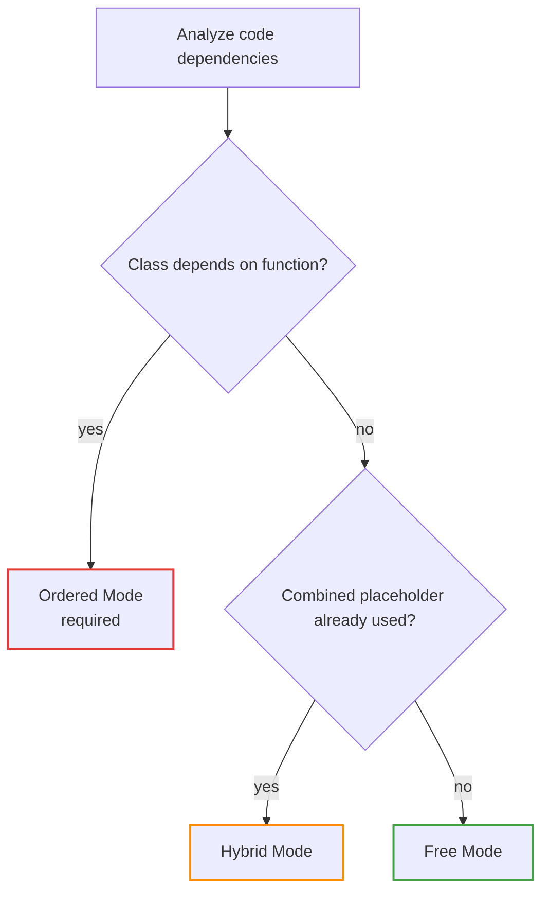

# Templates

A **template** is a plain text file that defines the structure of the generated output script.
PSScriptBuilder replaces placeholders with the collected and dependency-ordered source code
from [configured collectors](collectors.md). Static text before, between, and after placeholders
is preserved as-is.

The template is what separates PSScriptBuilder from a simple file concatenation tool. It gives
you full control over the structure of the output script — module header comments, `#Requires`
statements, fixed boilerplate, and the order of component blocks are all defined in the
template, not in the build script.

There isn't one fixed template structure that works for every project — whether your template
needs a placeholder for each collector individually or one combined placeholder for all of
them, and what order they must appear in, is determined by how your project's components
depend on each other.

PSScriptBuilder analyzes your code as part of every build. The dependencies that analysis finds
reveal which of three modes — **Free Mode**, **Hybrid Mode**, or **Ordered Mode** — is possible,
or in some cases required. Your existing template is then either suitable for that mode, or it
isn't.

Free Mode, possible whenever no dependency forces otherwise, is used throughout the Walkthrough
below; see [Ordered Mode and Hybrid Mode](#3-ordered-mode-and-hybrid-mode) for when the other
two apply.

Which mode applies, visualized:



---

## Walkthrough

A collector connects to the template through its `CollectionKey` — this is the value that
appears in the corresponding placeholder. Write a placeholder as double curly braces around
that key: `{{Key}}`. Matching is case-insensitive, so `{{CLASS_DEFINITIONS}}` and
`{{class_definitions}}` are equivalent.

Which key to use, and whether you need one placeholder per collector or a single combined one,
depends on the mode that applies:

- **Free Mode** — one placeholder per registered collector, using that collector's
  `CollectionKey` (see [Collection Keys](collectors.md#3-collection-keys) in the Collectors
  Guide) — except `Using` collectors, which always share a single combined placeholder, in
  every mode (see [Collectors Guide](collectors.md#using))
- **Ordered Mode** and **Hybrid Mode** — a single combined placeholder for all Enum, Class, and
  Function collectors together, using an ordered-components key

The template's filename is entirely up to you — PSScriptBuilder reads it as plain text
regardless of extension. This guide's examples use `.ps1.template`, but that final `.template`
extension means most editors won't offer PowerShell syntax highlighting or IntelliSense for it.
Naming it `.template.ps1` instead keeps "template" visible in the name while still ending in
`.ps1`, giving you that editor support too.

Each step below is a self-contained example illustrating one aspect of template syntax, the same
way the [Collectors Guide](collectors.md#walkthrough)'s Walkthrough does — neither builds on a
single running `$contentCollector` carried across steps.

### 1. Create a Template

The simplest template maps each collector type to a separate placeholder, in the order Free
Mode requires (see [Validation Modes](#validation-modes) for the exact rules). Instead of
writing one by hand, use
[`New-PSScriptBuilderTemplate`](../cmdlets/New-PSScriptBuilderTemplate.md) to generate it
automatically from your collector configuration:

```powershell
$contentCollector = New-PSScriptBuilderContentCollector |
    Add-PSScriptBuilderCollector -Type Enum     -IncludePath "src\Enums" |
    Add-PSScriptBuilderCollector -Type Class    -IncludePath "src\Classes" |
    Add-PSScriptBuilderCollector -Type Function -IncludePath "src\Public"

New-PSScriptBuilderTemplate `
    -ContentCollector $contentCollector `
    -OutputPath       "build\Templates\MyScript.ps1.template"
```

By default, `New-PSScriptBuilderTemplate` won't overwrite an existing template file — pass
`-Force` if you want to regenerate one, which replaces its entire content, including any manual
changes you made after it was first generated.

The generated file looks like this:

```powershell title="MyScript.ps1.template"
{{ENUM_DEFINITIONS}}

{{CLASS_DEFINITIONS}}

{{FUNCTION_DEFINITIONS}}
```

The token names match the default `CollectionKey` for each collector type — see the
[Collectors Guide](collectors.md#collector-types) for the full list.

### 2. Custom Collection Keys

To place two collectors of the same type in different sections of a template — for example,
keeping domain classes separate from shared library classes — register each one with its own
`-CollectionKey`, then use that key as the corresponding placeholder:

```powershell
$contentCollector = New-PSScriptBuilderContentCollector |
    Add-PSScriptBuilderCollector `
        -Type          Class `
        -CollectionKey "CORE_CLASSES" `
        -IncludePath   "src\Core" |
    Add-PSScriptBuilderCollector `
        -Type          Class `
        -CollectionKey "DOMAIN_CLASSES" `
        -IncludePath   "src\Domain"
```

```powershell title="MyScript.ps1.template"
{{CORE_CLASSES}}

{{DOMAIN_CLASSES}}
```

### 3. Ordered Mode and Hybrid Mode

Free Mode — what you've built so far — works whenever no dependency forces otherwise. The other
two modes exist for when it doesn't:

#### Ordered Mode

Activated automatically whenever a class depends on a function — even a single one-directional
dependency, such as a constructor or method calling a project-defined function.

PSScriptBuilder always requires Ordered Mode for this case rather than trying to determine
whether a simpler placeholder reordering would work: more complex projects can end up with
functions and classes depending on each other in ways a fixed two-block order can't satisfy, so
combining them into one dependency-ordered sequence handles every case correctly, simple or not.

#### Hybrid Mode

Activated manually, by placing the combined components placeholder in a template whose code has
*no* cross-dependencies yet.

Use it when you want a template that remains valid regardless of whether cross-dependencies are
introduced later — for example, when your project is still growing and you want to avoid
restructuring the template at the moment cross-dependencies first appear.

#### The Combined Placeholder

Both modes combine Enum, Class, and Function components into a single combined placeholder.
Using and File placeholders stay separate from it, and both remain optional. `File` keeps one
placeholder per registered File collector; `Using` always shares a single combined placeholder
across all registered Using collectors, in every mode (see [Collectors
Guide](collectors.md#using)):

```powershell title="MyScript.ps1.template"
{{USING_STATEMENTS}}
{{FILE_CONTENTS}}
{{ORDERED_COMPONENTS}}
```

The combined placeholder's default name is `ORDERED_COMPONENTS` — see
[Using a Custom Combined Placeholder Key](#using-a-custom-combined-placeholder-key) to customize it.

Together, these three placeholders are governed by the following rules:

- All Enum, Class, and Function components are combined into a single topologically ordered
  block at `{{ORDERED_COMPONENTS}}`
- Per-type placeholders for Enum, Class, and Function are forbidden in both modes
- `Using` and `File` placeholders remain valid and optional
- `Using` must appear before every other placeholder — `{{ORDERED_COMPONENTS}}` and `File`
  included

The last rule is the same one Free Mode enforces (PowerShell requires `using` statements to open
the script) — checked purely by template position, regardless of what a `File` placeholder's
actual content is.

#### Converting a Free Mode Template to Hybrid Mode

A Free Mode template fails validation the moment a class starts depending on a function — for
example, when a class method calls a newly added, project-defined function.

Most other Free Mode validation failures are simple template mistakes — a missing placeholder,
the wrong order, a typo — fixable within Free Mode itself. The one mentioned is different: no
template fix restores Free Mode once the dependency exists; switching to Hybrid or Ordered Mode
is the only way forward.

Converting to Hybrid Mode before that happens avoids the surprise, and the conversion itself is
simple: only the template's placeholders change, with no restructuring of your build script or
collectors.

The same template before and after converting to Hybrid Mode:

```powershell title="MyScript.ps1.template (Free Mode)"
{{USING_STATEMENTS}}

{{FILE_CONTENTS}}

{{ENUM_DEFINITIONS}}

{{CLASS_DEFINITIONS}}

{{FUNCTION_DEFINITIONS}}
```

```powershell title="MyScript.ps1.template (Hybrid Mode)"
{{USING_STATEMENTS}}

{{FILE_CONTENTS}}

{{ORDERED_COMPONENTS}}
```

The three collector-specific placeholders — `{{ENUM_DEFINITIONS}}`, `{{CLASS_DEFINITIONS}}`,
`{{FUNCTION_DEFINITIONS}}` — combine into the single combined `{{ORDERED_COMPONENTS}}` placeholder;
`{{USING_STATEMENTS}}` and `{{FILE_CONTENTS}}` stay exactly as they were.

#### Using a Custom Combined Placeholder Key

Change the combined placeholder's default name only if your template already uses
`ORDERED_COMPONENTS` for something else — otherwise, the default works fine. Override it with
`-OrderedComponentsKey` on
[`Invoke-PSScriptBuilderBuild`](../cmdlets/Invoke-PSScriptBuilderBuild.md) and
[`Test-PSScriptBuilderTemplate`](../cmdlets/Test-PSScriptBuilderTemplate.md). To keep the
template and the build call in sync, store a custom key in `psscriptbuilder.config.json`:

```json title="psscriptbuilder.config.json"
{
    "build": {
        "orderedComponentsKey": "MY_COMPONENTS"
    }
}
```

Then use it in your build script like this:

```powershell
$config = Get-PSScriptBuilderConfiguration
Invoke-PSScriptBuilderBuild -ContentCollector $contentCollector `
    -TemplatePath "build\Templates\MyProject.ps1.template" `
    -OutputPath   "build\Output\MyProject.ps1" `
    -OrderedComponentsKey $config.Build.OrderedComponentsKey
```

### 4. Combining with Release Management Tokens

A build template can also contain release metadata tokens — version numbers, build timestamps,
Git commit hashes — using the same `{{Token}}` syntax as collector placeholders:

```powershell title="MyScript.ps1.template"
# Version: {{VERSION}}
# Built: {{BUILD_TIMESTAMP}}

{{ENUM_DEFINITIONS}}

{{CLASS_DEFINITIONS}}

{{FUNCTION_DEFINITIONS}}
```

To replace these tokens with real values before the build runs, call
[`Update-PSScriptBuilderBumpFiles`](../cmdlets/Update-PSScriptBuilderBumpFiles.md). By the time
`Invoke-PSScriptBuilderBuild` validates the template, the release tokens are already gone, and
the build validator only ever sees the collector placeholders it manages itself. If a release
token is still present when the build runs — for example, because the bump step was skipped —
the validator has no way to tell it apart from a genuine mistake, and reports it as an unknown
placeholder.

See the [Release Management Guide](release-management.md) for how to configure which files and
tokens get updated, the required call order, and the full token list.

### 5. Escaping Literal Placeholder Text

Sometimes a template needs to mention a `{{Key}}`-shaped placeholder in plain prose, without that
mention being treated as a real, functioning placeholder.

Writing four braces instead of two around the key escapes it: `{{{{Key}}}}` renders as the
literal, two-brace text `{{Key}}` in the output, and is never replaced or validated against a
registered collector.

The text between the braces can be anything — it doesn't need to match a registered collector's
key, or even look like a valid identifier. For example, `{{{{this could be any text at all}}}}`
renders as the literal text `{{this could be any text at all}}`, with no relation to any
registered collector.

In practice, this often looks like a comment that mentions a real collector key, such as the
following:

```powershell title="MyScript.ps1.template"
# Example: you could switch to Hybrid mode by using {{{{ORDERED_COMPONENTS}}}} instead
{{ENUM_DEFINITIONS}}

{{CLASS_DEFINITIONS}}

{{FUNCTION_DEFINITIONS}}
```

Without the extra braces, this comment's mention of `{{ORDERED_COMPONENTS}}` would itself be
treated as the real placeholder, forcing Hybrid Mode and failing validation for a template that
never intended to use it.

This also works with several escaped mentions together, for example when a template uses custom
collection keys that a header comment should document:

```powershell title="MyScript.ps1.template"
# This template accepts either individual placeholders ({{{{CORE_CLASSES}}}},
# {{{{DOMAIN_CLASSES}}}}) or the combined {{{{ORDERED_COMPONENTS}}}} placeholder,
# depending on your project's dependencies.

{{CORE_CLASSES}}

{{DOMAIN_CLASSES}}
```

Each `{{{{...}}}}` mention is escaped independently — the comment can name as many placeholders as
needed, while the real, unescaped placeholders below it are still replaced normally.

If a placeholder-shaped mention is left unescaped by mistake, the resulting validation error
includes a hint pointing at this syntax, to make the fix easy to find.

### 6. Validate Your Template

A mismatch between the collectors you registered and the placeholders in the template — a
missing token, a typo in a key, or a wrong ordering — will cause the build to fail with a
validation error. Whether your template is suitable for the mode your project's code requires
isn't something you have to run a full build to find out.
[`Test-PSScriptBuilderTemplate`](../cmdlets/Test-PSScriptBuilderTemplate.md) runs the same
collection and dependency analysis a real build would — so it sees the same cross-dependencies —
then reports whether the template is valid, without writing any output.

Validate your template whenever you add or rename a collector, change a `-CollectionKey`, or
edit the template file:

```powershell
$contentCollector = New-PSScriptBuilderContentCollector |
    Add-PSScriptBuilderCollector -Type Class    -IncludePath "src\Classes" |
    Add-PSScriptBuilderCollector -Type Function -IncludePath "src\Public"

if (Test-PSScriptBuilderTemplate `
        -ContentCollector $contentCollector `
        -TemplatePath     "build\Templates\MyProject.ps1.template") {
    Invoke-PSScriptBuilderBuild `
        -ContentCollector $contentCollector `
        -TemplatePath     "build\Templates\MyProject.ps1.template" `
        -OutputPath       "build\Output\MyProject.ps1"
}
```

Since `Test-PSScriptBuilderTemplate` returns only `$true` or `$false`, a failing result on its
own doesn't say why — add `-Verbose` to see the specific validation error.

For a detailed result instead of a plain boolean — exactly which mode was detected, or which
placeholders are missing or unknown — use
[`Get-PSScriptBuilderTemplateAnalysis`](../cmdlets/Get-PSScriptBuilderTemplateAnalysis.md)
piped to [`Format-PSScriptBuilderTemplateAnalysis`](../cmdlets/Format-PSScriptBuilderTemplateAnalysis.md)
for the full analysis result:

```powershell
Get-PSScriptBuilderTemplateAnalysis `
    -ContentCollector $contentCollector `
    -TemplatePath     "build\Templates\MyProject.ps1.template" |
    Format-PSScriptBuilderTemplateAnalysis
```

---

## Reference

### Placeholder Rules

Placeholder matching is case-insensitive. Beyond that, PSScriptBuilder checks these rules for
every template, in both Free and Ordered/Hybrid Mode, before any content is written to the
output:

- **No whitespace** inside the braces — `{{ Key }}` is invalid and causes a validation error
- Each placeholder may appear **only once** in the template
- Only keys matching a registered collector (or `{{ORDERED_COMPONENTS}}`) are valid
- An escaped placeholder (`{{{{Key}}}}`) is never treated as a real placeholder — see
  [Escaping Literal Placeholder Text](#5-escaping-literal-placeholder-text)

### Validation Modes

Which mode applies is determined by your code's actual dependencies, not by choice — see the
Walkthrough above for how. This table is the complete summary:

| Mode | When activated | Required | Forbidden |
|---|---|---|---|
| **Free** | No cross-dependencies and no combined components placeholder in template | One placeholder per collector (`Using`: exactly one shared placeholder, regardless of how many `Using` collectors are registered) | — |
| **Hybrid** | No cross-dependencies, but combined components placeholder present in template | Combined components placeholder | Per-type placeholders for `Enum`, `Class`, `Function` |
| **Ordered** | A class depends on a function, even a single one-directional case (automatic) | Combined components placeholder | Per-type placeholders for `Enum`, `Class`, `Function` |

In Free Mode, two ordering rules are enforced:

- `Using` placeholders must appear before all others
- `Enum` placeholders must appear before all `Class` and `Function` placeholders

The position of `File` placeholders is unrestricted relative to `Enum`, `Class`, and `Function`.

In Ordered and Hybrid mode, `Using` placeholders must appear before every other placeholder,
including `File` placeholders and the combined components placeholder — the same rule Free Mode
enforces.

### Validation Error Reference

Match the exact error text from a failed `Test-PSScriptBuilderTemplate`,
`Get-PSScriptBuilderTemplateAnalysis`, or `Invoke-PSScriptBuilderBuild` call against this table:

| Error | Cause | Fix |
|---|---|---|
| Whitespace in placeholder | `{{ Key }}` instead of `{{Key}}` | Remove whitespace inside braces |
| Missing combined components placeholder | Ordered or Hybrid mode but placeholder absent | Add the combined components placeholder to the template |
| Forbidden placeholder in Ordered/Hybrid mode | `{{CLASS_DEFINITIONS}}` etc. present when the combined components placeholder is used | Remove per-type placeholders; use only the combined components placeholder |
| Collector placeholder missing | A registered collector (other than `Using`) has no matching placeholder | Add `{{CollectionKey}}` for each collector |
| Using placeholder missing | One or more `Using` collectors are registered, but no `Using` placeholder is present | Add a placeholder for one of the registered Using collectors |
| Wrong placeholder order (Using) | A non-`Using` placeholder appears before `{{USING_STATEMENTS}}` | Move `Using` placeholders before all others |
| Multiple Using placeholders | More than one Using collector placeholder present when multiple Using collectors are registered | Use only the placeholder for the first-registered Using collector; remove the others |
| Wrong placeholder order (Enum) | A `Class` or `Function` placeholder appears before `{{ENUM_DEFINITIONS}}` | Move `Enum` placeholders before all `Class` and `Function` placeholders |
| Duplicate placeholder | Same `{{Key}}` appears more than once | Remove the duplicate |
| Unknown placeholder | `{{UNKNOWN}}` has no corresponding collector | Remove it or register a matching collector |

---

## See Also

- [Collectors Guide](collectors.md) — registering collectors and their `CollectionKey`
- [Type Reference: Templates](../reference/types.md#templates) — full `PSScriptBuilderTemplateGenerationResult` and `PSScriptBuilderTemplateAnalysisResult` property tables
- [Release Management Guide](release-management.md) — version tokens and bump file configuration
- [Dependency Analysis Guide](dependency-analysis.md) — how cross-dependencies are detected
- [File Watching Guide](file-watching.md) — the template directory is watched too; template changes always trigger a rebuild
