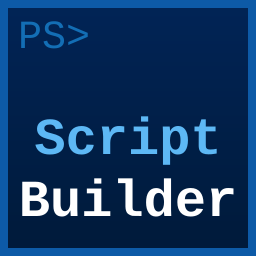

---
hide:
  - navigation
  - toc
title: PSScriptBuilder
---

  
  

    
PSScriptBuilder

    
A PowerShell module that builds a single deployable script from multi-file projects &mdash; with automatic dependency resolution, topological sorting, and integrated release management.

  

-   **Getting Started**

    ---

    The fastest path from zero to a working, dependency-ordered script &mdash; install the
    module, scaffold a project, and run your first build.

    [:octicons-arrow-right-24: Getting Started](getting-started/index.md)

-   **Tutorials**

    ---

    End-to-end walkthroughs for three independent scenarios: a first project, migrating
    existing code, and release management.

    [:octicons-arrow-right-24: Tutorials](tutorials/index.md)

-   **Guides**

    ---

    In-depth explanations grouped by area: building a script, analyzing its structure, and
    publishing a release.

    [:octicons-arrow-right-24: Guides](guides/index.md)

-   **Reference**

    ---

    Complete reference for every public cmdlet and the PowerShell types they return &mdash; parameters, outputs, and properties.

    [:octicons-arrow-right-24: Reference](reference/index.md)

-   **Examples**

    ---

    Seventeen runnable examples from a simple function build to a full release workflow.

    [:octicons-arrow-right-24: Examples](examples.md)

-   **Troubleshooting**

    ---

    Common problems and their solutions, covering builds, configuration, templates, and
    environment diagnostics.

    [:octicons-arrow-right-24: Troubleshooting](troubleshooting.md)

